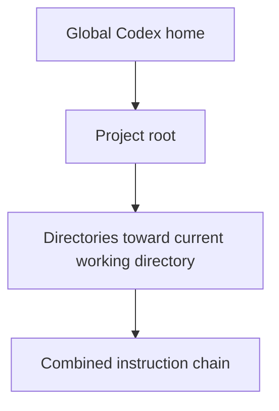

# Project instructions with AGENTS.md

`AGENTS.md` gives Codex durable guidance about a repository: the commands to
run, conventions to preserve, and checks that define finished work. Keep it
small, specific, and close to the files it governs.

## Learning objectives

By the end of this module, you will be able to:

- Explain global, project, and nested instruction scopes.
- Write a concise root `AGENTS.md`.
- Add a nested file for directory-specific guidance.
- Use `AGENTS.override.md` intentionally.
- Verify which instructions Codex loaded.
- Separate agent guidance from mechanical enforcement.

## How discovery works

Codex builds an instruction chain once at the start of a run or interactive
session.



The discovery order is:

1. In the Codex home directory, use `AGENTS.override.md` when present;
   otherwise use `AGENTS.md`.
2. From the project root toward the current working directory, inspect each
   directory for `AGENTS.override.md`, then `AGENTS.md`, then configured fallback
   filenames.
3. Include at most one instruction file per directory.
4. Combine files from broadest to most specific, so guidance nearer the current
   directory appears later and can supersede broader guidance.

Empty files are ignored. The combined project instruction size defaults to 32
KiB; keep files focused or split guidance into the relevant subdirectories.

## Choose the right scope

| Requirement                               | Location                             |
| ----------------------------------------- | ------------------------------------ |
| Personal preferences across repositories  | `~/.codex/AGENTS.md`                 |
| Temporary personal global override        | `~/.codex/AGENTS.override.md`        |
| Team conventions for the whole repository | `<repo>/AGENTS.md`                   |
| Rules for one service or package          | `<repo>/<subdir>/AGENTS.md`          |
| Intentional replacement at one level      | `<repo>/<subdir>/AGENTS.override.md` |
| One task only                             | Current prompt, not `AGENTS.md`      |

Use a regular nested `AGENTS.md` when you want to add more specific guidance.
Use `AGENTS.override.md` when that directory should select the override file
instead of the regular file at the same level.

## What belongs in AGENTS.md

Useful content changes how Codex works in this repository:

- Build, test, lint, and documentation commands.
- Architecture boundaries and important entry points.
- Naming, formatting, or API conventions not enforced elsewhere.
- Files or directories that must not be generated or edited.
- Required verification and review expectations.
- Directory-specific commands that differ from the repository default.

Avoid:

- Copying the README or architecture documentation in full.
- Generic advice Codex already knows.
- Long style rules that a formatter or linter can enforce.
- Secrets, credentials, personal paths, and ephemeral task details.
- Instructions that claim permission to bypass user approval.

Pair guidance with CI, linters, type checkers, and tests. `AGENTS.md` explains
what matters; deterministic tooling enforces what can be checked mechanically.

## Create a project instruction file

In the Codex CLI, `/init` can generate an initial scaffold in the current
directory:

```text
/init
```

You can also create the file manually. A useful minimal structure is:

```markdown
# AGENTS.md

## Repository map

- `src/` contains application code.
- `tests/` mirrors the source tree.

## Commands

- Install: `npm install`
- Test: `npm test`
- Type-check: `npm run typecheck`

## Working agreements

- Preserve public API compatibility unless the task explicitly changes it.
- Keep unrelated files untouched.
- Add or update tests when behavior changes.

## Completion

- Run the narrowest relevant test during iteration.
- Run `npm test` and `npm run typecheck` before handoff.
```

Start with commands you have verified locally. Add rules when a repeated error,
review comment, or navigation problem demonstrates a real need.

## Add directory-specific guidance

Suppose a repository uses `npm test` generally, but the payment service has a
separate command and stricter change rule:

```text
repository/
├── AGENTS.md
└── services/
    └── payments/
        └── AGENTS.override.md
```

The nested override can contain:

```markdown
# Payments service instructions

- Run `make test-payments` instead of the repository-wide test command.
- Never change payment-event schemas without a migration and compatibility test.
- Treat test fixtures as synthetic; never copy production transaction data.
```

When Codex starts in `services/payments`, it combines the global and root
guidance with this more specific file.

## Copy-ready templates

- [Project AGENTS.md template](project-AGENTS.md)
- [Nested AGENTS.override.md template](nested-AGENTS.override.md)

Copy them into a practice project:

```bash
cp 02-agents-md/project-AGENTS.md /path/to/project/AGENTS.md
mkdir -p /path/to/project/services/example
cp 02-agents-md/nested-AGENTS.override.md \
  /path/to/project/services/example/AGENTS.override.md
```

Edit every placeholder before relying on the files.

## Verify active instructions

Start a new CLI run from the repository root:

```bash
codex --cd /path/to/project --ask-for-approval never \
  "Summarize the instruction files you loaded and list their key requirements. Do not modify files."
```

Then verify the nested scope:

```bash
codex --cd /path/to/project/services/example --ask-for-approval never \
  "Summarize the instruction files you loaded and explain which test command applies here. Do not modify files."
```

Expected result: the nested run reports the repository guidance plus the more
specific service guidance, and selects the service's test command.

`--ask-for-approval never` means a non-interactive run cannot request new
approval; it does not grant extra access. These prompts are read-only by
instruction, but the active sandbox still defines the actual execution
boundary.

## Hands-on exercise: layered guidance

1. Copy the project template into a disposable repository.
2. Replace every placeholder with real repository commands and paths.
3. Add a nested instruction file for one directory with a genuinely different
   verification command.
4. Start fresh Codex runs at the root and nested directory.
5. Ask each run to summarize active instructions without editing.
6. Compare the answers with the files you created.

### Success criteria

- The root run reports only applicable global and root guidance.
- The nested run also reports the directory-specific guidance.
- The correct verification command is selected at each scope.
- No instruction duplicates secrets or large sections of existing docs.

## Review rules

For Codex code review, place a `## Code Review Rules` section in the closest
applicable `AGENTS.md`. Write rules that identify a concrete risky behavior and
give a safe path or exception.

```markdown
## Code Review Rules

- Flag authorization decisions based only on client-provided role fields.
  Safe path: derive authorization from the verified server-side identity.
```

Reserve formatting rules for automated tooling unless formatting can hide a
real correctness or security problem.

## Advanced configuration

If a repository already has a durable instruction filename, list it as a
fallback in Codex configuration:

```toml
project_doc_fallback_filenames = ["TEAM_GUIDE.md"]
project_doc_max_bytes = 65536
```

Codex still checks `AGENTS.override.md` and `AGENTS.md` first. Restart the CLI
or open a new session after changing discovery configuration or instruction
files.

## Troubleshooting

### No instructions load

- Confirm the file is non-empty and named correctly.
- Use `/pwd` or `codex status` to verify the project root.
- Start a new run after editing instruction files.

### The wrong rule applies

- Search parent directories and the Codex home directory for
  `AGENTS.override.md`.
- Check whether a nested file is closer to the current working directory.
- Inspect configured fallback filenames.

### Content is truncated

- Remove duplicated background material.
- Move specialized rules into nested directories.
- Increase `project_doc_max_bytes` only when the additional context is truly
  needed.

### Guidance keeps growing

Add a rule only when it prevents a repeated, consequential mistake. Move
reference material to normal documentation and mechanical checks to CI.

## Next step

Continue to [Skills](../03-skills/README.md) to package repeatable workflows that should
be discoverable but do not belong in every task's instruction context.

## Official resources

- [Custom instructions with AGENTS.md](https://learn.chatgpt.com/docs/agent-configuration/agents-md.md)
- [Codex customization](https://learn.chatgpt.com/docs/customization/overview.md)
- [Configuration basics](https://learn.chatgpt.com/docs/config-file/config-basic.md)
