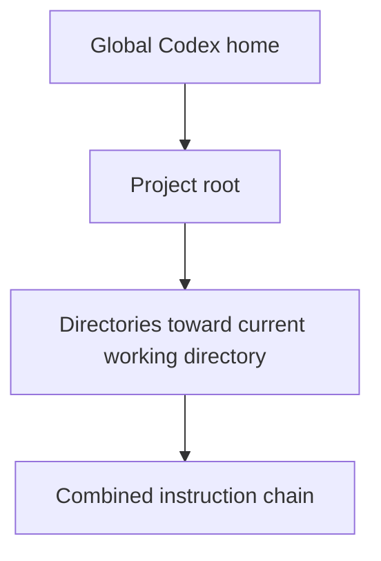

# Project instructions with AGENTS.md

`AGENTS.md` gives Codex durable guidance about a repository: the commands to run, conventions to preserve, and checks that define finished work. Keep it small, specific, and close to the files it governs.

## Learning objectives

By the end of this module, you will be able to:

- Explain global, project, and nested instruction scopes.
- Write a concise root `AGENTS.md`.
- Add a nested file for directory-specific guidance.
- Use `AGENTS.override.md` intentionally.
- Verify which instructions Codex loaded.
- Separate agent guidance from mechanical enforcement.

## Before you begin

You need the Codex CLI available and authenticated for the surface you plan to
use. This exercise creates a small disposable Git repository; it does not use
the Codex How To repository itself.

The practice repository must be its own project root. Do not create it inside
another checkout, a monorepo, or a directory tree that already contains a
project-level `AGENTS.md`. A parent instruction file can change the experiment
before you have learned how layering works. The setup below uses `mktemp` and
`git init` so the practice directory has a fresh root. Your global
`~/.codex/AGENTS.md`, if present, is intentionally still part of the test.

## How discovery works

Codex builds an instruction chain once at the start of a run or interactive session.



The discovery order is:

1. In the Codex home directory, use `AGENTS.override.md` when present; otherwise use `AGENTS.md`.
2. From the project root toward the current working directory, inspect each directory for `AGENTS.override.md`, then `AGENTS.md`, then configured fallback filenames.
3. Include at most one instruction file per directory.
4. Combine files from broadest to most specific, so guidance nearer the current directory appears later and can supersede broader guidance.

Empty files are ignored. The combined project instruction size defaults to 32 KiB; keep files focused or split guidance into the relevant subdirectories.

## Choose the right scope

| Requirement                               | Location                             |
| ----------------------------------------- | ------------------------------------ |
| Personal preferences across repositories  | `~/.codex/AGENTS.md`                 |
| Temporary personal global override        | `~/.codex/AGENTS.override.md`        |
| Team conventions for the whole repository | `<repo>/AGENTS.md`                   |
| Rules for one service or package          | `<repo>/<subdir>/AGENTS.md`          |
| Intentional replacement at one level      | `<repo>/<subdir>/AGENTS.override.md` |
| One task only                             | Current prompt, not `AGENTS.md`      |

Use a regular nested `AGENTS.md` when you want to add more specific guidance.
Use `AGENTS.override.md` when that directory should select the override file instead of the regular file at the same level.

## What belongs in AGENTS.md

Useful content changes how Codex works in this repository:

- Build, test, lint, and documentation commands.
- Architecture boundaries and important entry points.
- Naming, formatting, or API conventions not enforced elsewhere.
- Files or directories that must not be generated or edited.
- Required verification and review expectations.
- Directory-specific commands that differ from the repository default.

Avoid:

- Copying the README or architecture documentation in full.
- Generic advice Codex already knows.
- Long style rules that a formatter or linter can enforce.
- Secrets, credentials, personal paths, and ephemeral task details.
- Instructions that claim permission to bypass user approval.

Pair guidance with CI, linters, type checkers, and tests. `AGENTS.md` explains what matters; deterministic tooling enforces what can be checked mechanically.

## Hands-on exercise: layered guidance

Follow these steps in order. The first directory you enter is the tutorial
checkout, and the first directory in which you run Codex is the disposable
practice project. Do not run `/init` before entering that practice project.

### Step 0 — Enter the tutorial checkout

Use the real path to this checkout. This gives the shell an explicit source for
the copy-ready templates and prevents relative paths from becoming ambiguous.

```bash
cd /path/to/codex-howto
TUTORIAL_ROOT="$PWD"
```

### Step 1 — Create an isolated practice project

Create a fresh Git root outside this checkout. Do not place it inside another
repository, monorepo, or directory tree that already has a project-level
`AGENTS.md`.

```bash
PRACTICE_ROOT="$(mktemp -d "${TMPDIR:-/tmp}/codex-agents-practice.XXXXXX")"
git init -q "$PRACTICE_ROOT"
printf '%s\n' '# Disposable Codex instructions practice' > "$PRACTICE_ROOT/README.md"
printf 'Practice project: %s\n' "$PRACTICE_ROOT"
test "$(git -C "$PRACTICE_ROOT" rev-parse --show-toplevel)" = "$PRACTICE_ROOT"
find "$PRACTICE_ROOT" \( -name 'AGENTS.md' -o -name 'AGENTS.override.md' \) -print
```

The last command must print nothing. The fresh Git root ensures that the
project-level discovery starts here; a global `~/.codex/AGENTS.md`, if present,
is intentionally still part of the experiment.

### Step 2 — Enter the practice project before using Codex

This is the critical directory step. `/init` acts on the current project, so
running it from `$TUTORIAL_ROOT` would modify the wrong repository.

```bash
cd "$PRACTICE_ROOT"
pwd
codex
```

Confirm that `pwd` prints `$PRACTICE_ROOT`. Only then type the slash command in
the Codex session:

```text
/init
```

Exit Codex after it creates the scaffold. If you prefer a fully manual file,
skip `/init` and continue with the template option in Step 3; do not use both
methods for the root file.

### Step 3 — Finalize the root guidance

Choose exactly one path:

- **Generated path:** inspect the `AGENTS.md` created by `/init`, replace its
  placeholders, and keep only commands you have verified in this practice
  project.
- **Template path:** return to the tutorial checkout and copy the template:

  ```bash
  cd "$TUTORIAL_ROOT"
  cp 02-agents-md/project-AGENTS.md "$PRACTICE_ROOT/AGENTS.md"
  ```

If you choose the template path, replace every bracketed placeholder before
continuing. The root file describes the whole practice project, not one service.
If you choose the generated path, edit that generated file in place instead;
do not overwrite it with the template afterward.

The following is the minimum useful shape:

```markdown
# AGENTS.md

## Repository map

- `src/` contains application code.
- `tests/` mirrors the source tree.

## Commands

- Install: `npm install`
- Test: `npm test`
- Type-check: `npm run typecheck`

## Working agreements

- Preserve public API compatibility unless the task explicitly changes it.
- Keep unrelated files untouched.
- Add or update tests when behavior changes.

## Completion

- Run the narrowest relevant test during iteration.
- Run `npm test` and `npm run typecheck` before handoff.
```

Start with commands you have verified locally. Add rules when a repeated error,
review comment, or navigation problem demonstrates a real need.

### Step 4 — Add directory-specific guidance

Suppose a repository uses `npm test` generally, but the payment service has a separate command and stricter change rule:

```text
repository/
├── AGENTS.md
└── services/
    └── payments/
        └── AGENTS.override.md
```

The nested override can contain:

```markdown
# Payments service instructions

- Run `make test-payments` instead of the repository-wide test command.
- Never change payment-event schemas without a migration and compatibility test.
- Treat test fixtures as synthetic; never copy production transaction data.
```

When Codex starts in `services/payments`, it combines the global and root guidance with this more specific file.

Return to the tutorial checkout and copy the nested template into the directory
you will create for this step:

```bash
cd "$TUTORIAL_ROOT"
mkdir -p "$PRACTICE_ROOT/services/example"
cp 02-agents-md/nested-AGENTS.override.md \
  "$PRACTICE_ROOT/services/example/AGENTS.override.md"
```

Replace its placeholders and keep the nested rule genuinely specific to that directory. A nested file is useful when the service needs a different command, test fixture policy, or review rule; it is not a place to duplicate the root file.

## Copy-ready templates

- [Project AGENTS.md template](project-AGENTS.md)
- [Nested AGENTS.override.md template](nested-AGENTS.override.md)

The templates are used in Steps 3 and 4. Edit every placeholder before relying
on the files.

## Verify active instructions

### Step 5 — Verify the root scope

Start a new CLI run at the practice project root:

```bash
codex --cd "$PRACTICE_ROOT" --ask-for-approval never \
  "Summarize the instruction files you loaded and list their key requirements. Do not modify files."
```

Then verify the nested scope:

```bash
codex --cd "$PRACTICE_ROOT/services/example" --ask-for-approval never \
  "Summarize the instruction files you loaded and explain which test command applies here. Do not modify files."
```

Expected result: the nested run reports the repository guidance plus the more
specific service guidance, and selects the service's test command.

The root run should not report the nested service rule because its current
directory is above `services/example`. The nested run should report both root
guidance and the more specific file. If both runs report an unexpected rule,
stop and inspect parent directories and `~/.codex/` before continuing.

`--ask-for-approval never` means a non-interactive run cannot request new approval; it does not grant extra access. These prompts are read-only by instruction, but the active sandbox still defines the actual execution boundary.

### Expected result

| Check | What you should observe | What it proves |
|---|---|---|
| Root run from `$PRACTICE_ROOT` | Global guidance (if any) plus root guidance | Project-wide instructions apply at the project root |
| Nested run from `services/example` | Root guidance plus the nested, more specific guidance | Later directory guidance is included for that subtree |
| Verification command selection | Root command at the root; service command below the nested directory | Scope-specific workflow rules are discoverable |
| Safety review | No secrets, personal paths, or copied documentation in either file | Guidance stays concise and safe to share |

### Learning outcome

After the exercise, you should be able to draw the instruction chain for a new
working directory, explain why a nested file changes behavior only below its
directory, and identify when a parent or global file is affecting a result. You
should also know that `AGENTS.md` guides Codex but does not replace tests,
linters, permissions, or approval controls.

### Step 6 — Clean up

When you are done, remove only the disposable repository created for this
exercise:

```bash
rm -rf "$PRACTICE_ROOT"
unset PRACTICE_ROOT
```

Do not substitute the Codex How To repository path for `$PRACTICE_ROOT`.

## Review rules

For Codex code review, place a `## Code Review Rules` section in the closest applicable `AGENTS.md`. Write rules that identify a concrete risky behavior and give a safe path or exception.

```markdown
## Code Review Rules

- Flag authorization decisions based only on client-provided role fields.
  Safe path: derive authorization from the verified server-side identity.
```

Reserve formatting rules for automated tooling unless formatting can hide a real correctness or security problem.

## Advanced configuration

If a repository already has a durable instruction filename, list it as a fallback in Codex configuration:

```toml
project_doc_fallback_filenames = ["TEAM_GUIDE.md"]
project_doc_max_bytes = 65536
```

Codex still checks `AGENTS.override.md` and `AGENTS.md` first. Restart the CLI or open a new session after changing discovery configuration or instruction files.

## Troubleshooting

### No instructions load

- Confirm the file is non-empty and named correctly.
- Use `/pwd` or `codex status` to verify the project root.
- Start a new run after editing instruction files.

### The wrong rule applies

- Search parent directories and the Codex home directory for `AGENTS.override.md`.
- Check whether a nested file is closer to the current working directory.
- Inspect configured fallback filenames.

### Content is truncated

- Remove duplicated background material.
- Move specialized rules into nested directories.
- Increase `project_doc_max_bytes` only when the additional context is truly needed.

### Guidance keeps growing

Add a rule only when it prevents a repeated, consequential mistake. Move reference material to normal documentation and mechanical checks to CI.

## Next step

Continue to [Skills](../03-skills/README.md) to package repeatable workflows that should be discoverable but do not belong in every task's instruction context.

## Official resources

- [Custom instructions with AGENTS.md](https://learn.chatgpt.com/docs/agent-configuration/agents-md.md)
- [Codex customization](https://learn.chatgpt.com/docs/customization/overview.md)
- [Configuration basics](https://learn.chatgpt.com/docs/config-file/config-basic.md)
