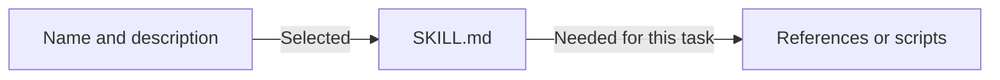

# Skills

Skills package repeatable workflows as focused instructions with optional
references, scripts, assets, and UI metadata. Codex can select a skill from its
description or the user can invoke it explicitly with `$skill-name`.

## Learning objectives

- Decide whether guidance belongs in a prompt, `AGENTS.md`, a skill, or a plugin.
- Explain progressive disclosure.
- Create a valid `SKILL.md` with precise trigger language.
- Add supporting resources only when they improve the workflow.
- Test explicit and implicit invocation.
- Validate a skill before sharing it.

## Choose the right mechanism

| Need                                                         | Use            |
| ------------------------------------------------------------ | -------------- |
| One task's requirements                                      | Current prompt |
| Rules that apply to every repository task                    | `AGENTS.md`    |
| A repeatable, discoverable workflow                          | Skill          |
| An installable bundle with connectors or multiple components | Plugin         |

A skill does not grant permission to perform external or destructive actions.
It describes the workflow; normal sandbox, approval, and tool permissions still
apply.

## Use a skill in Codex CLI

You do not run a skill as a shell command. Mention it in the Codex prompt, then
tell Codex what you want it to do:

1. At the prompt, type `$` and choose a skill from the suggestions. You can
   also type its full name, such as `$lesson-quiz`.
2. After the skill name, write your request in the same prompt. For example:

   ```text
   $lesson-quiz Quiz me on Module 1 as a pre-test.
   ```

3. Send the prompt. Codex applies that skill's instructions to your request.

You can also type `/skills` and select a skill from the list. If the skill is
not listed, check that it is available to this project or your Codex setup.
After adding a skill, restart Codex if it still does not appear.

The `$` mention is an explicit request to use that skill. Codex may also select
a skill automatically when your request matches its description, but naming it
is the clearest way to start when you are learning.

## Progressive disclosure



Codex initially sees skill metadata for discovery. It loads `SKILL.md` after
selecting the skill, then reads only the supporting resources needed for the
current task.

## Skill locations

| Scope         | Location                    | Use                                   |
| ------------- | --------------------------- | ------------------------------------- |
| Repository    | `.agents/skills/<name>/`    | Shared project workflow               |
| User          | `~/.agents/skills/<name>/`  | Personal workflow across repositories |
| Administrator | `/etc/codex/skills/<name>/` | Managed machine defaults              |
| System        | Bundled with Codex          | OpenAI-provided capabilities          |

Within a repository, Codex scans `.agents/skills` from the current working
directory toward the repository root. Skills with the same `name` are not
merged.

## Minimal structure

```text
my-skill/
└── SKILL.md
```

```markdown
---
name: my-skill
description: Describe the concrete workflow and when it should apply.
---

# My skill

State the outcome, important decisions, constraints, and output requirements.
```

Names use lowercase letters, digits, and hyphens. The directory should match
the skill name.

## Write a discriminating description

The description controls discovery. Front-load the user goal and add a boundary
when a neighboring workflow could trigger incorrectly.

```yaml
description: Review a code change for concrete correctness, security, and test risks. Use for pull requests, diffs, or requested code review. Do not use for implementing the fix unless the user asks.
```

Avoid descriptions such as “helps with code.” They are too broad to route
reliably.

## Add resources intentionally

```text
my-skill/
├── SKILL.md
├── agents/
│   └── openai.yaml
├── references/
├── scripts/
└── assets/
```

- `references/`: policies, schemas, detailed checklists, or mode-specific
  instructions read only when relevant.
- `scripts/`: deterministic operations that would otherwise be reimplemented
  repeatedly. Run and test new scripts.
- `assets/`: files copied or adapted into output.
- `agents/openai.yaml`: optional UI metadata, invocation policy, and MCP
  dependencies.

Do not add empty directories, duplicated README files, or scripts for work the
agent can perform reliably with existing tools.

## Optional UI metadata

```yaml
interface:
  display_name: "Code Review Specialist"
  short_description: "Review code for concrete correctness risks"
  default_prompt: "Use $code-review-specialist to review this change."
```

Implicit invocation is enabled by default. Set
`policy.allow_implicit_invocation: false` only for an intentionally explicit-only
skill. An MCP dependency makes a tool available; the instructions must still
explain when and how to use it.

## Create a skill

Invoke the built-in creator and describe the outcome and trigger:

```text
$skill-creator Create a project skill named release-notes that drafts release
notes from the current Git diff. It must separate user-visible changes from
internal changes and must not publish anything.
```

For manual creation, place the directory under `.agents/skills/` and create
`SKILL.md`. Codex normally detects changes automatically; restart the client if
the skill does not appear.

## Invoke and test

In the CLI or IDE extension, type `$` to mention a skill or use `/skills` to
browse available skills.

Test five request shapes:

1. A direct request that should invoke it.
2. An indirect request expressing the same goal.
3. Missing input that should cause one focused question.
4. A neighboring request that should not invoke it.
5. An edge case where the skill must stop rather than invent information.

Metadata controls whether the skill is chosen. The body controls what it does
after selection; diagnose those failures separately.

## Validate

If you have the `skill-creator` package installed, run its validator:

```bash
python3 /path/to/skill-creator/scripts/quick_validate.py \
  .agents/skills/my-skill
```

The validator checks structure, frontmatter, naming, and unfinished scaffold
placeholders. It does not prove that trigger decisions or outputs are useful.

## Copy-ready examples

- [Code review specialist](examples/code-review-specialist/SKILL.md) uses a
  focused entrypoint plus a conditional review checklist.
- [Documentation maintainer](examples/docs-maintainer/SKILL.md) shows a compact,
  instruction-only skill.
- [`$self-assessment`](../.agents/skills/self-assessment/SKILL.md) and
  [`$lesson-quiz`](../.agents/skills/lesson-quiz/SKILL.md) are active project
  skills used by this curriculum.

To try an example in another repository:

```bash
mkdir -p /path/to/project/.agents/skills
cp -R 03-skills/examples/code-review-specialist \
  /path/to/project/.agents/skills/
```

Review copied instructions before using them; tutorial examples are not a
substitute for repository-specific policy.

## Hands-on exercise

1. Create `.agents/skills/change-summary/SKILL.md` in a disposable repository.
2. Write a description that triggers for summarizing a Git diff, but not for
   writing code or committing changes.
3. Require a user-impact summary, risk list, and verification list.
4. Invoke it explicitly with `$change-summary`.
5. Ask indirectly: “Summarize this branch for a reviewer.”
6. Ask: “Implement the missing tests.” Confirm the skill does not claim the
   implementation task.

### Success criteria

- The skill validates structurally.
- Direct and matching indirect requests select it.
- The neighboring request does not incorrectly route to it.
- The output is grounded in the actual diff and invents no changes.

## Troubleshooting

### The skill does not appear

- Confirm `SKILL.md` has valid `name` and `description` fields.
- Confirm it is under a scanned `.agents/skills` path.
- Check for a duplicate name and restart Codex if necessary.

### The skill triggers too often

Narrow the description around the recognizable user goal and add one meaningful
exclusion.

### The skill is selected but behaves poorly

Improve the body, inputs, decision points, or output contract. Move large
conditional details into linked references.

## Next step

Continue to [Subagents](../04-subagents/README.md) when work should run in a focused
agent thread rather than merely follow a workflow in the current one.

## Official resources

- [Build skills](https://learn.chatgpt.com/docs/build-skills.md)
- [Plugin skill format](https://developers.openai.com/plugins/build/skills.md)
