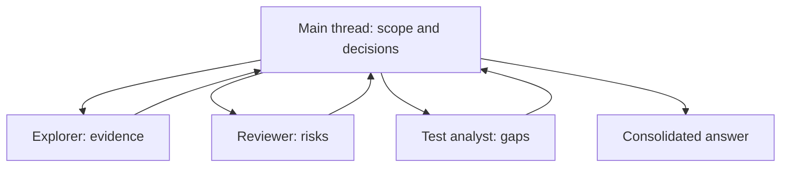

# Subagents

Subagents run bounded work in separate agent threads and return focused results
to the main conversation. Use them when specialization or genuine parallelism
outweighs their token and coordination cost.

## Learning objectives

- Choose tasks that benefit from delegation.
- Distinguish built-in roles from custom agents.
- Create a valid `.codex/agents/*.toml` definition.
- Understand inherited permissions, skills, and MCP servers.
- Coordinate parallel work without overlapping file ownership.
- Inspect, steer, and consolidate agent results.

## The orchestration model



The main thread should retain requirements, decisions, and integration. Move
noisy exploration, test output, or independent specialist analysis into
subagent threads and request concise evidence-backed summaries.

## When to use subagents

Good candidates:

- Independent security, correctness, and test reviews of the same diff.
- Read-heavy exploration across separate subsystems.
- Documentation research that can run beside codebase investigation.
- A clearly owned implementation slice after interfaces are agreed.

Poor candidates:

- A tiny sequential task.
- Work that requires constant shared decisions.
- Multiple agents editing the same files.
- Delegation used only to avoid reading the result yourself.

Each subagent performs its own model and tool work, so delegation usually uses
more tokens than a comparable single-agent task.

## Built-in agents

Current Codex clients provide these built-in roles:

- `default`: general-purpose fallback.
- `worker`: implementation and fixes.
- `explorer`: read-heavy codebase exploration.

Ask directly for delegation. For example:

```text
Review this branch with three independent subagents. Have one inspect
correctness, one inspect security boundaries, and one inspect missing tests.
Keep all three read-only by instruction, wait for every result, then consolidate
only actionable findings with file references.
```

In the CLI, use `/subagents` to inspect and switch among agent threads.
Supported app and IDE clients surface subagent activity in their own UI.

## Custom-agent locations

| Scope    | Location                      |
| -------- | ----------------------------- |
| Project  | `.codex/agents/<name>.toml`   |
| Personal | `~/.codex/agents/<name>.toml` |

Each standalone file defines one agent and requires:

- `name`
- `description`
- `developer_instructions`

The `name` field is the agent identity. Matching the filename is a useful
convention but not the source of truth.

## Minimal custom agent

```toml
name = "api_reviewer"
description = "Read-only reviewer for API compatibility and error behavior."
developer_instructions = """
Review changed API behavior without editing files.
Trace request validation, authorization, response schemas, and error mapping.
Return only evidence-backed findings with file references and a failure case.
"""
```

Optional fields can select model behavior or disable supported capabilities.
Avoid hard-coding a model in a shared tutorial template unless the team has
verified availability for every intended user.

## Inheritance and boundaries

Subagents inherit the parent session's sandbox and approval settings. A custom
agent file cannot grant itself broader filesystem, network, provider, or MCP
access.

Instructions such as “do not edit files” shape behavior but do not create a
separate read-only sandbox. Set security boundaries on the parent session and
use capability flags only as defense in depth.

Custom agents inherit parent skills and MCP servers. They may disable supported
features or individual skills, but configuring a new MCP server belongs in the
parent configuration.

## Global subagent settings

Project or user configuration can set defaults:

```toml
[agents]
enabled = true
max_concurrent_threads_per_session = 4
```

Leave model and reasoning defaults unset unless the workflow has a verified
reason to override the parent. More concurrent agents increase cost and can
make coordination harder.

## Design a useful role

A strong custom agent has:

- One recognizable job.
- A description that tells the orchestrator when to choose it.
- Explicit non-goals.
- A concise output contract.
- Evidence and verification expectations.

Avoid “senior developer who can do anything” roles. They duplicate the main
agent and provide little routing value.

## Copy-ready examples

- [Codebase explorer](examples/codebase-explorer.toml)
- [Risk reviewer](examples/risk-reviewer.toml)
- [Implementation worker](examples/implementation-worker.toml)
- [Project subagent configuration](examples/subagents-config.toml)

Install one example into a project:

```bash
mkdir -p /path/to/project/.codex/agents
cp 04-subagents/examples/risk-reviewer.toml \
  /path/to/project/.codex/agents/risk-reviewer.toml
```

Review its instructions and restart or open a fresh session before testing.

## Coordinate parallel work

Give every agent:

1. A bounded question or owned file set.
2. The minimum context required.
3. Clear read/write expectations.
4. A result format and evidence requirement.
5. A request to wait for all required peers before consolidation.

For parallel implementation, allocate disjoint files or components. If agents
must edit the same interface, resolve the contract first and serialize the
edits.

## Approvals and failures

An approval request can originate from a background agent. Inspect which thread
requested it and the exact action before deciding. In a run that cannot surface
new approval, an action requiring approval fails and the failure returns to the
parent workflow.

Do not broaden parent permissions merely to make a subagent workflow smoother.
Narrow the task or perform the sensitive step explicitly in the main thread.

## Hands-on exercise: parallel review

This exercise uses two read-only custom agents to review one small Git diff.
Follow the steps in order. The first directory in which you run Codex must be
the disposable practice repository, not this tutorial checkout.

### Step 0 — Enter the tutorial checkout

```bash
cd /path/to/codex-howto
TUTORIAL_ROOT="$PWD"
```

### Step 1 — Create an isolated practice repository

Create the practice project outside this checkout, outside another repository,
and outside a parent tree that already contains a project-level `AGENTS.md`.
This gives subagent discovery one clear project root.

```bash
PRACTICE_ROOT="$(mktemp -d "${TMPDIR:-/tmp}/codex-subagents-practice.XXXXXX")"
git init -q "$PRACTICE_ROOT"
printf '%s\n' '# Subagent review practice' '' 'Baseline project description.' > "$PRACTICE_ROOT/README.md"
git -C "$PRACTICE_ROOT" add README.md
git -C "$PRACTICE_ROOT" -c user.name='Codex learner' -c user.email='codex-learner.invalid' commit -qm 'Create practice baseline'
printf '%s\n' 'This line is the intentional review change.' >> "$PRACTICE_ROOT/README.md"
mkdir -p "$PRACTICE_ROOT/.codex/agents"
cp 04-subagents/examples/codebase-explorer.toml "$PRACTICE_ROOT/.codex/agents/codebase_explorer.toml"
cp 04-subagents/examples/risk-reviewer.toml "$PRACTICE_ROOT/.codex/agents/risk_reviewer.toml"
cp 04-subagents/examples/subagents-config.toml "$PRACTICE_ROOT/.codex/config.toml"
printf 'Practice project: %s\n' "$PRACTICE_ROOT"
test "$(git -C "$PRACTICE_ROOT" rev-parse --show-toplevel)" = "$PRACTICE_ROOT"
find "$PRACTICE_ROOT" \( -name 'AGENTS.md' -o -name 'AGENTS.override.md' \) -print
```

This setup creates a baseline commit, adds one known README change for review,
copies two custom agent definitions, and enables up to four concurrent agents.
The final `find` command should print nothing. If you already know how to make
this isolated repository, you may skip the setup block, assign your absolute
path to `PRACTICE_ROOT`, and prepare the same files yourself.

### Step 2 — Enter the practice project and inspect the baseline

Enter the project before starting Codex. The custom agents are discovered from
the current project root.

```bash
cd "$PRACTICE_ROOT"
pwd
git status --short
git diff -- README.md
```

Expected result: `pwd` prints `$PRACTICE_ROOT`, the status shows only the
modified `README.md`, and the diff contains the one intentional line.

### Step 3 — Start Codex and confirm agent configuration

```bash
codex
```

Inside the Codex prompt, run `/pwd` and confirm the practice path. Then use
`/subagents` to inspect the available agent threads or roles. The project files
are definitions that the main session can use; they do not grant permissions
and do not edit the repository by themselves.

### Step 4 — Delegate bounded, read-only work

Paste this complete request:

```text
Review the current README.md diff without editing files or committing anything.
Delegate two bounded read-only tasks: ask codebase_explorer to map the changed
path and report confirmed evidence, then ask risk_reviewer to check correctness,
security boundaries, reliability, and missing tests using that evidence. Keep
their work non-overlapping, wait for both results, and consolidate the final
answer into user impact, actionable findings, checks run, and remaining
uncertainty. Cite README.md for every finding and do not invent tests.
```

The explorer owns evidence mapping; the risk reviewer owns risk analysis. The
main thread owns requirements and consolidation. Neither subagent should edit
the practice repository.

### Step 5 — Inspect and evaluate the results

Use `/subagents` while the work is running to inspect activity. When the main
agent returns, check the working tree from a terminal:

```bash
git status --short
git diff -- README.md
```

Expected result: the original one-line diff is unchanged, no new files were
created by the review, and the answer distinguishes confirmed findings from
uncertainty. A correct review should mention the README change and state that
there is no application behavior or test suite to inspect, rather than inventing
a security issue.

### Step 6 — Verify the agent definitions independently

Exit Codex and verify the copied configuration:

```bash
test -f .codex/agents/codebase_explorer.toml
test -f .codex/agents/risk_reviewer.toml
test -f .codex/config.toml
rg -n '^name =|^description =|developer_instructions|enabled|max_concurrent' .codex/agents .codex/config.toml
git status --short
```

Expected result: all three files exist, both agents are explicitly read-only in
their instructions, concurrency is set to 4, and only the intentional
`README.md` change remains in the working tree.

### Success criteria

- The practice project has a clear root and a known, reviewable diff.
- Each subagent receives a bounded, non-overlapping read-only role.
- Results cite `README.md` and separate evidence from uncertainty.
- Neither subagent edits files or commits changes.
- The main thread consolidates duplicate findings without overstating risk.

### What you learned

You practiced when delegation is useful, how custom agents are discovered, how
parent permissions constrain subagents, and why the main thread must retain
scope, decisions, and integration responsibility.

### Step 7 — Clean up

Remove only the disposable repository after reviewing the result:

```bash
rm -rf "$PRACTICE_ROOT"
unset PRACTICE_ROOT TUTORIAL_ROOT
```

Do not substitute the Codex How To repository path for `$PRACTICE_ROOT`.

## Troubleshooting

### Codex does not choose the custom agent

- Confirm the file is under `.codex/agents/` and contains all required fields.
- Make the description more specific about the role's trigger.
- Ask explicitly for the named role in a fresh session.

### Agents produce conflicting edits

Stop overlapping work, assign disjoint ownership, and integrate through the
main thread. Use worktrees for stronger checkout isolation when appropriate.

### Delegation costs more without improving the result

Reduce the number of agents, use faster roles for narrow scans, or keep the task
sequential. Parallelism is useful only when work is meaningfully independent.

## Next step

Continue to [MCP](../05-mcp/README.md) when an agent or skill needs tools and context that
live outside the repository.

## Official resource

- [Subagents](https://learn.chatgpt.com/docs/agent-configuration/subagents.md)
