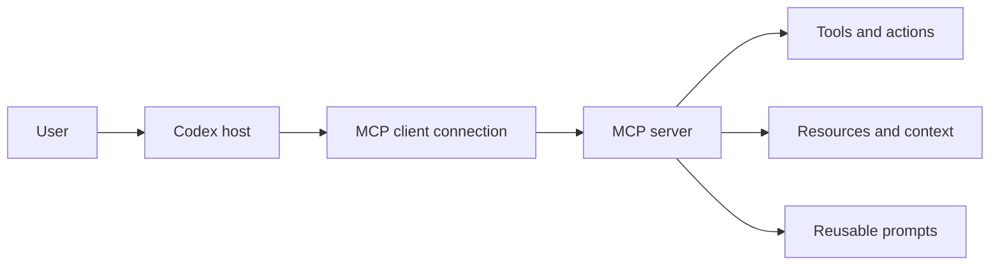

# Model Context Protocol

MCP connects Codex to tools and context outside the repository. Configure the
smallest capability set that supports the workflow, keep credentials outside
version control, and review which tools can mutate external systems.

## Learning objectives

- Explain host, client, server, tool, resource, and prompt roles.
- Choose between stdio and streamable HTTP transport.
- Configure personal or trusted-project MCP servers.
- Handle environment variables, bearer tokens, and OAuth safely.
- Restrict exposed tools and approval behavior.
- Diagnose startup, authentication, and availability problems.

## Architecture and trust



The server defines what it exposes; Codex configuration decides whether to
connect, which tools remain visible, and how approval works. The underlying
service still enforces its own identity and authorization.

Treat every server as executable or privileged integration code. Review its
publisher, transport, command, requested credentials, and tool semantics before
enabling it.

## Choose a transport

| Transport           | Configuration                 | Best fit                               |
| ------------------- | ----------------------------- | -------------------------------------- |
| **stdio**           | `command` and optional `args` | Local server process launched by Codex |
| **Streamable HTTP** | `url`                         | Remote or independently managed server |

For stdio servers, Codex starts a process and can pass selected environment
variables. For HTTP servers, authentication may use OAuth, a bearer-token
environment variable, or configured headers.

## Configuration scope

Codex stores MCP settings in `config.toml`:

- Personal: `~/.codex/config.toml`
- Trusted project: `.codex/config.toml`

The desktop app, CLI, and IDE extension share the local configuration. ChatGPT
web does not read local Codex config files; hosted ChatGPT workflows use
installed plugins and workspace-enabled connections.

Do not commit personal tokens or OAuth client secrets in project configuration.

## Configure with the CLI

Add a streamable HTTP server:

```bash
codex mcp add openaiDeveloperDocs --url https://developers.openai.com/mcp
```

Add a stdio server:

```bash
codex mcp add context7 -- npx -y @upstash/context7-mcp
```

The stdio example downloads and executes a third-party npm package. Review and
pin third-party dependencies according to your organization's policy before
using it in a trusted environment.

Inspect configuration without exposing credentials:

```bash
codex mcp list
codex mcp get openaiDeveloperDocs
codex mcp --help
```

In the interactive CLI, `/mcp` shows active servers and their tools.

## Configure stdio in TOML

```toml
[mcp_servers.context7]
command = "npx"
args = ["-y", "@upstash/context7-mcp"]
startup_timeout_sec = 20
tool_timeout_sec = 60
```

Use `env_vars` to forward existing environment variables without placing their
values in the file:

```toml
[mcp_servers.internal_docs]
command = "internal-docs-mcp"
env_vars = ["INTERNAL_DOCS_TOKEN"]
```

The process receives the named variable only when it exists in the selected
execution environment.

## Configure streamable HTTP in TOML

```toml
[mcp_servers.openaiDeveloperDocs]
url = "https://developers.openai.com/mcp"
```

For bearer-token authentication, store only the environment variable name:

```toml
[mcp_servers.example_service]
url = "https://mcp.example.invalid/mcp"
bearer_token_env_var = "EXAMPLE_MCP_TOKEN"
```

`.invalid` is a reserved non-working domain used here as a placeholder. Replace
it with the reviewed server URL and set the environment variable outside the
repository.

## OAuth

For a configured server that supports OAuth, start authentication with:

```bash
codex mcp login <server-name>
```

Register the exact callback URL Codex displays. OAuth behavior depends on the
server metadata and client-registration method; do not guess or hard-code a
callback from another environment.

If a confidential client requires a client secret, avoid command history and
project files. Review where the CLI persists the resulting configuration and
credentials before using it on a shared machine.

## Limit tools and approvals

Restrict a server to the tools the workflow needs:

```toml
[mcp_servers.example_service]
url = "https://mcp.example.invalid/mcp"
enabled_tools = ["search", "read_document"]
default_tools_approval_mode = "prompt"

[mcp_servers.example_service.tools.search]
approval_mode = "approve"
output_token_limit = 12000
```

- `enabled_tools` is an allowlist.
- `disabled_tools` is applied after the allowlist.
- `default_tools_approval_mode` accepts `auto`, `prompt`, `writes`, or
  `approve`.
- Per-tool `approval_mode` overrides the server default.

Tool annotations help with decisions but do not replace review of the server's
actual behavior.

## Pair MCP with skills

MCP provides live capability; a skill describes a repeatable workflow that uses
it. For example, a documentation-research skill can require searching an MCP
server, opening the primary page, and returning exact citations.

When a skill requires a server, declare the dependency in
`agents/openai.yaml`. The dependency does not authorize external actions or
replace workflow instructions.

## Copy-ready examples

- [OpenAI Docs HTTP server](examples/openai-docs-http.toml)
- [Context7 stdio server](examples/context7-stdio.toml)
- [Restricted HTTP tools](examples/restricted-http-tools.toml)

Copy the relevant table into a reviewed `config.toml`; do not concatenate every
example by default.

## Hands-on exercise: read-only documentation server

1. Review the OpenAI Docs server URL in official documentation.
2. Add it with `codex mcp add` or copy the HTTP TOML example into an appropriate
   config scope.
3. Run `codex mcp list` and inspect it with `/mcp`.
4. Ask Codex to search for one documented topic and open the primary result.
5. Confirm the response includes a direct official link.
6. Remove or disable the server after the exercise if it is not needed.

### Success criteria

- The server initializes without credentials in the repository.
- Only expected tools appear.
- Retrieved claims link to the primary official page.
- You can identify the configuration scope and transport.

## Troubleshooting

### Server fails at startup

- Run the stdio command directly and inspect its error output.
- Check executable availability, arguments, working directory, and forwarded
  environment-variable names.
- Increase `startup_timeout_sec` only after identifying a legitimate slow start.

### HTTP server connects but tools fail

- Confirm the URL and transport.
- Check whether OAuth or a bearer-token environment variable is required.
- Inspect allowlists, denylists, and approval modes.
- Reauthenticate after a revoked or expired credential.

### It works in CLI but not ChatGPT web

Local CLI, IDE, and desktop clients share local config. ChatGPT web does not
load it; use an allowed plugin or workspace connection for hosted chats.

### Too many tools appear

Add an `enabled_tools` allowlist and a conservative approval mode. Disable the
server when the current workflow does not need it.

## Next step

Continue to [Hooks](../06-hooks/README.md) for deterministic automation around Codex
lifecycle events.

## Official resources

- [Model Context Protocol](https://learn.chatgpt.com/docs/extend/mcp.md)
- [Configuration reference](https://learn.chatgpt.com/docs/config-file/config-reference.md)
- [OpenAI Docs MCP](https://developers.openai.com/learn/docs-mcp)
