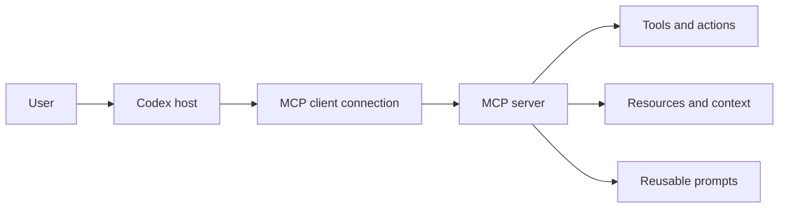

# Model Context Protocol

MCP connects Codex to tools and context outside the repository. Configure the
smallest capability set that supports the workflow, keep credentials outside
version control, and review which tools can mutate external systems.

## Learning objectives

- Explain host, client, server, tool, resource, and prompt roles.
- Choose between stdio and streamable HTTP transport.
- Configure personal or trusted-project MCP servers.
- Handle environment variables, bearer tokens, and OAuth safely.
- Restrict exposed tools and approval behavior.
- Diagnose startup, authentication, and availability problems.

## Architecture and trust



The server defines what it exposes; Codex configuration decides whether to
connect, which tools remain visible, and how approval works. The underlying
service still enforces its own identity and authorization.

Treat every server as executable or privileged integration code. Review its
publisher, transport, command, requested credentials, and tool semantics before
enabling it.

## Choose a transport

| Transport           | Configuration                 | Best fit                               |
| ------------------- | ----------------------------- | -------------------------------------- |
| **stdio**           | `command` and optional `args` | Local server process launched by Codex |
| **Streamable HTTP** | `url`                         | Remote or independently managed server |

For stdio servers, Codex starts a process and can pass selected environment
variables. For HTTP servers, authentication may use OAuth, a bearer-token
environment variable, or configured headers.

## Configuration scope

Codex stores MCP settings in `config.toml`:

- Personal: `~/.codex/config.toml`
- Trusted project: `.codex/config.toml`

The desktop app, CLI, and IDE extension share the local configuration. ChatGPT
web does not read local Codex config files; hosted ChatGPT workflows use
installed plugins and workspace-enabled connections.

Do not commit personal tokens or OAuth client secrets in project configuration.

## Configure with the CLI

Add a streamable HTTP server:

```bash
codex mcp add openaiDeveloperDocs --url https://developers.openai.com/mcp
```

Add a stdio server:

```bash
codex mcp add context7 -- npx -y @upstash/context7-mcp
```

The stdio example downloads and executes a third-party npm package. Review and
pin third-party dependencies according to your organization's policy before
using it in a trusted environment. Context7 can serve basic requests without a
key; an API key is a separate Context7 credential used for authenticated access
and higher limits. Codex does not create or supply that key automatically.

Inspect configuration without exposing credentials:

```bash
codex mcp list
codex mcp get openaiDeveloperDocs
codex mcp --help
```

In the interactive CLI, `/mcp` shows active servers and their tools.

## Configure stdio in TOML

These snippets belong in a Codex TOML configuration file: use
`~/.codex/config.toml` for a personal server or `<repo>/.codex/config.toml`
for a trusted project-specific server. Do not paste them into `AGENTS.md`.

```toml
[mcp_servers.context7]
command = "npx"
args = ["-y", "@upstash/context7-mcp"]
# Optional: forward the key only when it exists in the process environment.
env_vars = ["CONTEXT7_API_KEY"]
startup_timeout_sec = 20
tool_timeout_sec = 60
```

If Context7 requires authentication for your account or workload, create the
key in Context7, keep its value outside the repository, and export it before
starting Codex. Do not put the literal key in `args`, `config.toml`, or a
committed `.env` file. For example, enter it through a secret manager or a
hidden prompt, then export it as `CONTEXT7_API_KEY`; the `env_vars` line above
forwards the existing value to the child process. If no key is exported, the
server may still start in anonymous mode with the provider's lower limits.

Use `env_vars` to forward existing environment variables without placing their
values in the file:

```toml
[mcp_servers.internal_docs]
command = "internal-docs-mcp"
env_vars = ["INTERNAL_DOCS_TOKEN"]
```

The process receives the named variable only when it exists in the selected
execution environment.

## Configure streamable HTTP in TOML

Add the following table to the same user- or project-scoped `config.toml` file:

```toml
[mcp_servers.openaiDeveloperDocs]
url = "https://developers.openai.com/mcp"
```

For bearer-token authentication, add this table to that same `config.toml`
file and store only the environment variable name:

```toml
[mcp_servers.example_service]
url = "https://mcp.example.invalid/mcp"
bearer_token_env_var = "EXAMPLE_MCP_TOKEN"
```

`.invalid` is a reserved non-working domain used here as a placeholder. Replace
it with the reviewed server URL and set the environment variable outside the
repository.

## OAuth

For a configured server that supports OAuth, start authentication with:

```bash
codex mcp login <server-name>
```

Register the exact callback URL Codex displays. OAuth behavior depends on the
server metadata and client-registration method; do not guess or hard-code a
callback from another environment.

If a confidential client requires a client secret, avoid command history and
project files. Review where the CLI persists the resulting configuration and
credentials before using it on a shared machine.

## Limit tools and approvals

Restrict a server to the tools the workflow needs:
Add these tables to the relevant server section in the same `config.toml` file.
This is optional and is useful only when the workflow needs a narrower allowlist
or explicit approval behavior.

```toml
[mcp_servers.example_service]
url = "https://mcp.example.invalid/mcp"
enabled_tools = ["search", "read_document"]
default_tools_approval_mode = "prompt"

[mcp_servers.example_service.tools.search]
approval_mode = "approve"
output_token_limit = 12000
```

- `enabled_tools` is an allowlist.
- `disabled_tools` is applied after the allowlist.
- `default_tools_approval_mode` accepts `auto`, `prompt`, `writes`, or
  `approve`.
- Per-tool `approval_mode` overrides the server default.

Tool annotations help with decisions but do not replace review of the server's
actual behavior.

## Pair MCP with skills

MCP provides live capability; a skill describes a repeatable workflow that uses
it. For example, a documentation-research skill can require searching an MCP
server, opening the primary page, and returning exact citations.

When a skill requires a server, declare the dependency in
`agents/openai.yaml`. The dependency does not authorize external actions or
replace workflow instructions.

## Copy-ready examples

- [OpenAI Docs HTTP server](examples/openai-docs-http.toml)
- [Context7 stdio server](examples/context7-stdio.toml)
- [Restricted HTTP tools](examples/restricted-http-tools.toml)

Copy the relevant table into a reviewed `config.toml`; do not concatenate every
example by default.

## Hands-on exercise: connect a read-only documentation server

This exercise configures the OpenAI Docs MCP server for one disposable project
and uses it for a read-only documentation lookup. Follow the steps in order.
The first directory in which you run Codex must be the practice repository, not
this tutorial checkout.

### Prerequisites

- Codex CLI installed and authenticated.
- `git`, `rg`, and a POSIX shell available on the PATH.
- Network access to `https://developers.openai.com/mcp` for the live MCP step.

```bash
codex --version
git --version
rg --version
```

If `rg` is unavailable, install it or replace the read-only scans with an
equivalent such as `grep -n`. If network access or the MCP server is
unavailable, continue with local configuration checks and record the live
connection as skipped; do not weaken approval settings.

### Step 0 — Enter the tutorial checkout

```bash
cd /path/to/codex-howto
TUTORIAL_ROOT="$PWD"
```

### Step 1 — Create an isolated practice repository

Create the practice project outside this checkout, outside another repository,
and outside a parent tree that already contains a project-level `AGENTS.md`.
The MCP configuration below is project-local and should not be copied into a
real project without reviewing its scope and approval mode.

```bash
PRACTICE_ROOT="$(mktemp -d "${TMPDIR:-/tmp}/codex-mcp-practice.XXXXXX")"
git init -q "$PRACTICE_ROOT"
mkdir -p "$PRACTICE_ROOT/.codex"
printf '%s\n' '# MCP practice project' > "$PRACTICE_ROOT/README.md"
printf 'Practice project: %s\n' "$PRACTICE_ROOT"
test "$(git -C "$PRACTICE_ROOT" rev-parse --show-toplevel)" = "$PRACTICE_ROOT"
find "$PRACTICE_ROOT" \( -name 'AGENTS.md' -o -name 'AGENTS.override.md' \) -print
```

The final command should print nothing. If you already know how to create a
clean practice repository, you may skip this setup block, assign its absolute
path to `PRACTICE_ROOT`, and create the same `.codex` directory yourself.

### Step 2 — Add the reviewed, project-local configuration

Create this file at `$PRACTICE_ROOT/.codex/config.toml`:

```bash
cat > "$PRACTICE_ROOT/.codex/config.toml" <<'EOF'
[mcp_servers.openaiDeveloperDocs]
url = "https://developers.openai.com/mcp"
enabled = true
default_tools_approval_mode = "prompt"
EOF
```

This declares a streamable HTTP server, keeps the configuration in the
practice project's `.codex` scope, and requires approval before a tool call.
It contains no token or OAuth secret. Do not add a bearer token unless the
server requires one; if it does, store only an environment-variable name and
keep the value outside the repository.

Inspect what you wrote before starting Codex:

```bash
sed -n '1,40p' "$PRACTICE_ROOT/.codex/config.toml"
rg -n 'token|secret|api[_-]?key|authorization' "$PRACTICE_ROOT/.codex" || true
```

Expected result: the server URL and `prompt` approval mode are visible, and the
credential scan prints nothing.

### Step 3 — Enter the practice project and inspect the server

Enter the project before starting Codex. This ensures the project-local
configuration is the one being tested.

```bash
cd "$PRACTICE_ROOT"
pwd
git status --short
codex mcp list
codex mcp get openaiDeveloperDocs
```

Expected result: `pwd` prints `$PRACTICE_ROOT`; the list shows the configured
server; and `get` shows the reviewed URL without any secret value. If the
server is unavailable, record the startup error and continue to the
configuration checks—do not weaken approval settings to hide the failure.

### Step 4 — Start Codex and inspect active tools

```bash
codex
```

Inside the Codex prompt, run `/pwd` and then `/mcp`. Confirm that the active
server is the project-local OpenAI Docs server. Read the displayed tool names
and annotations before approving anything; the configuration file is not a
substitute for reviewing server behavior.

### Step 5 — Make one read-only documentation request

Use this copy-ready prompt:

```text
Use only the configured OpenAI Docs MCP server to find the current official
documentation for Codex skills. Read the primary result, summarize the
definition in plain language, and include its direct official URL. Do not edit
files, call tools that mutate external systems, or use an unconfigured server.
Ask for approval before every MCP tool call.
```

Expected result: Codex requests approval for the MCP calls, retrieves an
official OpenAI documentation page, and includes a direct `https://` link. If
the server cannot connect, report the exact failure and do not substitute an
unverified source.

### Step 6 — Verify scope and safety independently

Exit Codex and run:

```bash
git status --short
git diff -- .codex/config.toml README.md
rg -n 'https://developers.openai.com/mcp|default_tools_approval_mode = "prompt"' .codex/config.toml
rg -n 'token|secret|api[_-]?key|authorization' .codex || true
```

Expected result: no application files changed, the configuration contains the
expected URL and approval mode, and no credential values are present. Explain
that `.codex/config.toml` is project-local while `~/.codex/config.toml` would
be personal configuration; the exercise intentionally uses the former.

### Success criteria

- The server is configured in the intended project scope with streamable HTTP.
- No token, OAuth secret, or account identifier is stored in the repository.
- The active server and tools are inspected before approval.
- The request is read-only and returns a primary official link, or records an
  actionable connection failure without inventing a result.
- You can explain transport, scope, approval mode, and credential handling.

### What you learned

You practiced treating MCP as a privileged integration: choose a transport,
configure the narrowest useful scope, inspect tools and approvals, keep
credentials outside version control, and verify the source of retrieved claims.

### Step 7 — Clean up

Exit Codex and remove only the disposable project when you are finished:

```bash
rm -rf "$PRACTICE_ROOT"
unset PRACTICE_ROOT TUTORIAL_ROOT
```

Do not substitute the Codex How To repository path for `$PRACTICE_ROOT`.

## Troubleshooting

### Server fails at startup

- Run the stdio command directly and inspect its error output.
- Check executable availability, arguments, working directory, and forwarded
  environment-variable names.
- Increase `startup_timeout_sec` only after identifying a legitimate slow start.

### HTTP server connects but tools fail

- Confirm the URL and transport.
- Check whether OAuth or a bearer-token environment variable is required.
- Inspect allowlists, denylists, and approval modes.
- Reauthenticate after a revoked or expired credential.

### It works in CLI but not ChatGPT web

Local CLI, IDE, and desktop clients share local config. ChatGPT web does not
load it; use an allowed plugin or workspace connection for hosted chats.

### Too many tools appear

Add an `enabled_tools` allowlist and a conservative approval mode. Disable the
server when the current workflow does not need it.

## Next step

Continue to [Hooks](../06-hooks/README.md) for deterministic automation around Codex
lifecycle events.

## Official resources

- [Model Context Protocol](https://learn.chatgpt.com/docs/extend/mcp.md)
- [Configuration reference](https://learn.chatgpt.com/docs/config-file/config-reference.md)
- [OpenAI Docs MCP](https://developers.openai.com/learn/docs-mcp)
