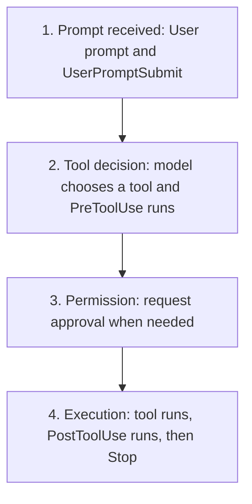

# Hooks

Hooks run deterministic commands or connected MCP tools at defined points in
the Codex lifecycle. Use them for small, testable checks and context injection,
not as a substitute for the sandbox, approvals, or service-side authorization.

## Learning objectives

- Decide whether behavior belongs in an instruction, skill, hook, or external
  policy boundary.
- Configure hooks in `hooks.json` or `config.toml`.
- Choose an event and matcher that cover the intended tool path.
- Parse event JSON and return event-specific output safely.
- Review hook trust, concurrency, timeouts, and failure behavior.
- Test a handler without risking a live Codex session.

## Choose the right mechanism

| Need                                      | Mechanism                        |
| ----------------------------------------- | -------------------------------- |
| Durable guidance for agent decisions      | `AGENTS.md`                      |
| A reusable multi-step workflow            | Skill                            |
| Deterministic action at a lifecycle point | Hook                             |
| Strong filesystem or network restriction  | Sandbox or managed policy        |
| Authorization for an external service     | Service identity and permissions |

Hooks are useful guardrails, but some specialized tool paths can bypass the
normal hook path. A hook script is also code running on the host. Review it with
the same care as a build script.

## Lifecycle model



The four phases keep the diagram readable. In exact event order, the path is
`UserPromptSubmit` → `PreToolUse` → `PermissionRequest` when needed → tool
execution → `PostToolUse` → `Stop`.

Other supported events cover session start and end, compaction, interruption,
and subagent start or stop. Select the narrowest event that can produce the
desired result.

`PreToolUse` can deny or rewrite supported calls before they run.
`PostToolUse` runs after the side effect and cannot undo it. Use post-tool hooks
for feedback, validation, or logging rather than prevention.

## Where hooks live

Codex loads hooks next to active configuration layers:

| Scope           | JSON                          | Inline TOML            |
| --------------- | ----------------------------- | ---------------------- |
| User            | `~/.codex/hooks.json`         | `~/.codex/config.toml` |
| Trusted project | `.codex/hooks.json`           | `.codex/config.toml`   |
| Plugin          | `hooks/hooks.json` by default | Declared by the plugin |

If one layer contains both JSON and inline TOML hooks, Codex loads both and
warns. Prefer one representation per layer so execution is easy to audit.

Project hooks load only after the project `.codex/` layer is trusted. Every
new or changed non-managed hook definition must also be reviewed and trusted.
Use `/hooks` in the CLI to inspect sources, review changes, or disable a hook.

## Configuration shape

A hook has three levels: event, matcher group, and handler.
For a project-scoped JSON configuration, save this object as
`<repo>/.codex/hooks.json`; for a user-scoped hook, use `~/.codex/hooks.json`.
Do not place JSON hook definitions in `AGENTS.md` or `.codex/config.toml`.

```json
{
  "description": "Repository safety examples.",
  "hooks": {
    "PreToolUse": [
      {
        "matcher": "^Bash$",
        "hooks": [
          {
            "type": "command",
            "command": "python3 \"$(git rev-parse --show-toplevel)/06-hooks/examples/pre_tool_policy.py\"",
            "timeout": 5,
            "statusMessage": "Checking shell command"
          }
        ]
      }
    ]
  }
}
```

The equivalent inline TOML syntax is available in
[`examples/hooks-config.toml`](examples/hooks-config.toml). Resolve repository
scripts from the Git root: Codex may start in a nested directory.

## Events and matchers

Matchers are regular expressions. Use anchors when an exact tool name is
intended.

| Event                           | Matcher input                                      | Typical use                                  |
| ------------------------------- | -------------------------------------------------- | -------------------------------------------- |
| `SessionStart`                  | `startup`, `resume`, `clear`, `compact`, or `fork` | Add concise session context                  |
| `PreToolUse`                    | Tool name                                          | Block or rewrite a supported call            |
| `PermissionRequest`             | Tool name                                          | Decide a request that already needs approval |
| `PostToolUse`                   | Tool name                                          | Inspect results after execution              |
| `PreCompact`, `PostCompact`     | `manual` or `auto`                                 | Preserve or validate compacted context       |
| `SubagentStart`, `SubagentStop` | Subagent type                                      | Add role context or request another pass     |
| `SessionEnd`                    | End reason                                         | Short cleanup or audit action                |

`UserPromptSubmit`, `Stop`, and `Interrupt` currently ignore matchers. Tool
coverage includes shell commands as `Bash`, `apply_patch` with `Edit` and
`Write` aliases, MCP tool names, and most local function tools. Hosted tools do
not use the local tool-hook path.

## Input and output

Every command handler receives one JSON object on standard input. Common fields
include `session_id`, `cwd`, `hook_event_name`, and `model`. Tool events also
include `tool_name`, `tool_input`, and, after execution, `tool_response`.

To deny a supported `PreToolUse` call, emit JSON on standard output:

```json
{
  "hookSpecificOutput": {
    "hookEventName": "PreToolUse",
    "permissionDecision": "deny",
    "permissionDecisionReason": "Repository policy blocks this command."
  }
}
```

Event output contracts differ. Do not copy a field from one event into another.
For example, `permissionDecision: "ask"` is not currently supported for
`PreToolUse`. An exit status of `2` with a reason on standard error is also a
blocking result for several events, but structured JSON is clearer to test.

## Build resilient command handlers

A command hook should:

1. Read exactly one JSON value from standard input.
2. Validate the event, tool name, and required nested fields.
3. Avoid printing diagnostic text to standard output.
4. Return only fields supported by that event.
5. Bound its runtime and output.
6. Avoid writing credentials, prompts, or transcripts to logs.

The example policy fails closed when a matching Bash event lacks valid input.
Its command patterns are intentionally narrow and illustrative; they are not a
complete shell parser or enterprise security boundary.

## Copy-ready examples

- [`examples/hooks.json`](examples/hooks.json) configures session context and a
  narrow pre-tool policy.
- [`examples/hooks-config.toml`](examples/hooks-config.toml) shows the same
  handler in inline TOML.
- [`examples/pre_tool_policy.py`](examples/pre_tool_policy.py) validates input
  and denies a short list of explicitly destructive command shapes.
- [`examples/session_start.py`](examples/session_start.py) adds concise context
  only when the repository contains `SECURITY.md`.
- [`examples/test_hooks.py`](examples/test_hooks.py) exercises both handlers
  without installing them.

Run the tests:

```bash
python3 06-hooks/examples/test_hooks.py
```

The tests invoke local scripts with simulated JSON. They do not install a hook
or execute any command being inspected.

## Concurrency, timeouts, and background work

Multiple matching command handlers for one event start concurrently. One
handler cannot prevent another from starting, even if it later returns a deny
decision. Design handlers independently and avoid shared writable state.

Most command hooks default to a long timeout, so set a small explicit timeout
for fast checks. `SessionEnd` and `Interrupt` have stricter one-to-three-second
limits. Use `async: true` only for informational background work: completion
does not start a new turn and output is delivered at the next safe point.

Keep model-visible output concise. Oversized `additionalContext` can be spilled
to a temporary file, which is another reason never to include secrets.

## Plugin hooks

An enabled plugin can provide `hooks/hooks.json`. Plugin hooks use the same
events and trust review as other non-managed hooks. Installing or enabling the
plugin does not automatically trust its hooks.

Plugin hook commands can use `PLUGIN_ROOT` for the installed plugin directory
and `PLUGIN_DATA` for writable plugin state. Do not assume the installed plugin
directory is writable.

## Hands-on exercise: test a safe pre-tool hook

This exercise installs the tutorial's session and pre-tool hooks in a disposable
Git repository, tests the handlers before starting Codex, and then reviews the
project hook configuration. Follow the steps in order. The first directory in
which you run Codex must be the practice repository, not this tutorial
checkout.

### Prerequisites

- Codex CLI installed and authenticated.
- Python 3, `git`, `rg`, and a POSIX shell available on the PATH.

```bash
codex --version
python3 --version
git --version
rg --version
```

Install `rg` or use an equivalent read-only search command before the
configuration inspection step.

### Step 0 — Enter the tutorial checkout

```bash
cd /path/to/codex-howto
TUTORIAL_ROOT="$PWD"
```

### Step 1 — Create an isolated practice repository

Create the practice project outside this checkout, outside another repository,
and outside a parent tree that already contains a project-level `AGENTS.md`.
Hooks execute host commands, so use a disposable project until you understand
the exact command and scope.

```bash
PRACTICE_ROOT="$(mktemp -d "${TMPDIR:-/tmp}/codex-hooks-practice.XXXXXX")"
git init -q "$PRACTICE_ROOT"
mkdir -p "$PRACTICE_ROOT/.codex" "$PRACTICE_ROOT/06-hooks/examples"
printf '%s\n' '# Hooks practice project' > "$PRACTICE_ROOT/README.md"
cp 06-hooks/examples/hooks.json "$PRACTICE_ROOT/.codex/hooks.json"
cp 06-hooks/examples/hooks-config.toml "$PRACTICE_ROOT/06-hooks/examples/hooks-config.toml"
cp 06-hooks/examples/pre_tool_policy.py "$PRACTICE_ROOT/06-hooks/examples/pre_tool_policy.py"
cp 06-hooks/examples/session_start.py "$PRACTICE_ROOT/06-hooks/examples/session_start.py"
cp 06-hooks/examples/test_hooks.py "$PRACTICE_ROOT/06-hooks/examples/test_hooks.py"
printf 'Practice project: %s\n' "$PRACTICE_ROOT"
test "$(git -C "$PRACTICE_ROOT" rev-parse --show-toplevel)" = "$PRACTICE_ROOT"
find "$PRACTICE_ROOT" \( -name 'AGENTS.md' -o -name 'AGENTS.override.md' \) -print
```

The copied paths intentionally match the commands in `hooks.json`: the hook
resolves the repository root and then imports the handler under
`06-hooks/examples`. The final `find` command should print nothing. If you
already know how to prepare this isolated repository, you may skip the setup
block, assign your absolute path to `PRACTICE_ROOT`, and copy the same files.

### Step 2 — Test handlers before enabling them

Run the provided tests from the practice project. These tests feed simulated
JSON to the handlers; they do not install a hook or execute the inspected shell
commands.

```bash
cd "$PRACTICE_ROOT"
pwd
python3 06-hooks/examples/test_hooks.py
```

Expected result: all tests pass. A failure here is a reason to inspect the
handler and input shape before opening a Codex session; do not enable a failing
hook just to see what it does live.

### Step 3 — Review the exact configuration

Inspect the hook definition, matcher, command path, and timeout:

```bash
sed -n '1,120p' .codex/hooks.json
rg -n 'PreToolUse|SessionStart|matcher|command|timeout' .codex/hooks.json
```

Expected result: `PreToolUse` matches exactly `Bash`, the command resolves from
the Git root, and the timeout is explicit. The example blocks only a narrow
set of destructive command shapes; it is not a complete shell parser or a
security boundary.

### Step 4 — Start Codex and inspect trust

Start Codex from the practice project:

```bash
codex
```

Inside the Codex prompt, run `/pwd` and confirm `$PRACTICE_ROOT`, then open
`/hooks`. Review the source, command, matcher, and trust state before enabling
or approving the project hook. A project hook may require a new trust decision
after its definition changes.

### Step 5 — Exercise the safe path

Ask Codex to run a harmless command:

```text
Run the harmless shell command `printf 'hook-safe'`. Do not edit files.
```

Expected result: the command runs and the pre-tool policy emits no denial. If
Codex asks for approval, inspect the exact command and approve only if it is the
expected harmless request.

### Step 6 — Exercise the deny path without running it

Do not ask Codex to execute a destructive command. Instead, run the existing
simulated-input tests and inspect the documented denial shape:

```bash
python3 06-hooks/examples/test_hooks.py
```

Expected result: malformed matching input is handled without a traceback and
blocked samples return `hookSpecificOutput` with `permissionDecision` set to
`deny`. This proves the handler logic without invoking `git reset --hard`,
forced cleanup, or another destructive command.

### Step 7 — Verify the working tree and cleanup scope

Exit Codex and inspect what changed:

```bash
git status --short
git diff -- .codex/hooks.json README.md
```

Expected result: the harmless command did not change the README or hook
definition. The copied practice files may appear as untracked files; no source
file outside the practice repository should be affected.

### Success criteria

- Handler tests pass before the live session starts.
- The hook has an explicit matcher, repository-root command path, and timeout.
- A safe command is allowed and a simulated destructive input is denied.
- No destructive command is executed during the exercise.
- You can explain why hooks are guardrails and why sandbox, approval, and
  service-side authorization remain the hard boundaries.

### What you learned

You practiced the complete hook workflow: copy a reviewed example, test the
JSON handler independently, inspect trust and matchers, observe a safe event,
and verify a deny path without risking a real side effect.

### Step 8 — Clean up

Exit Codex and remove only the disposable project:

```bash
rm -rf "$PRACTICE_ROOT"
unset PRACTICE_ROOT TUTORIAL_ROOT
```

Do not substitute the Codex How To repository path for `$PRACTICE_ROOT`.

## Troubleshooting

### The hook is listed but skipped

Open `/hooks`. Confirm the project is trusted and review the current hook hash.
Edits require a new trust decision.

### The handler never matches

Check the canonical tool name and matcher anchors. Shell and unified-exec calls
match `Bash`; edits match `apply_patch`, `Edit`, or `Write`.

### The handler prints output but Codex ignores it

Confirm the event supports that output field and that standard output contains
valid JSON. Plain text is ignored or invalid for several tool and stop events.

### A post-tool hook blocked too late

That is expected: the tool already ran. Move preventive logic to a supported
`PreToolUse` path and keep sandbox or managed policy as the hard boundary.

## Next step

Continue to [Plugins](../07-plugins/README.md) to package skills, connections, hooks, and
assets into a reusable distribution unit.

## Official resources

- [Hooks](https://learn.chatgpt.com/docs/hooks)
- [Advanced configuration](https://learn.chatgpt.com/docs/config-file/config-advanced)
- [Configuration reference](https://learn.chatgpt.com/docs/config-file/config-reference)
