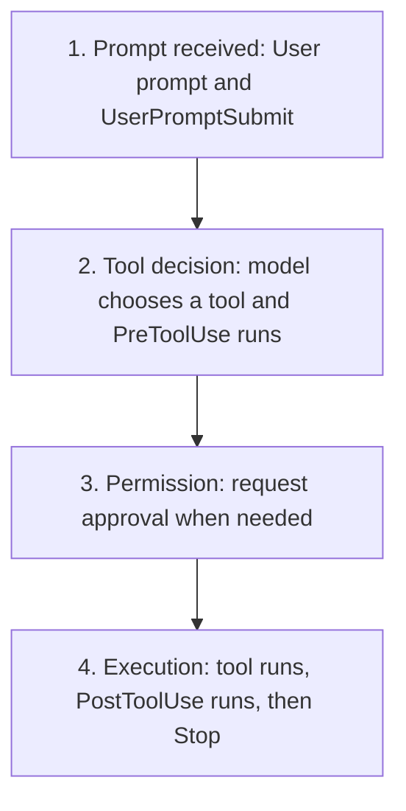

# Hooks

Hooks run deterministic commands or connected MCP tools at defined points in
the Codex lifecycle. Use them for small, testable checks and context injection,
not as a substitute for the sandbox, approvals, or service-side authorization.

## Learning objectives

- Decide whether behavior belongs in an instruction, skill, hook, or external
  policy boundary.
- Configure hooks in `hooks.json` or `config.toml`.
- Choose an event and matcher that cover the intended tool path.
- Parse event JSON and return event-specific output safely.
- Review hook trust, concurrency, timeouts, and failure behavior.
- Test a handler without risking a live Codex session.

## Choose the right mechanism

| Need                                      | Mechanism                        |
| ----------------------------------------- | -------------------------------- |
| Durable guidance for agent decisions      | `AGENTS.md`                      |
| A reusable multi-step workflow            | Skill                            |
| Deterministic action at a lifecycle point | Hook                             |
| Strong filesystem or network restriction  | Sandbox or managed policy        |
| Authorization for an external service     | Service identity and permissions |

Hooks are useful guardrails, but some specialized tool paths can bypass the
normal hook path. A hook script is also code running on the host. Review it with
the same care as a build script.

## Lifecycle model



The four phases keep the diagram readable. In exact event order, the path is
`UserPromptSubmit` → `PreToolUse` → `PermissionRequest` when needed → tool
execution → `PostToolUse` → `Stop`.

Other supported events cover session start and end, compaction, interruption,
and subagent start or stop. Select the narrowest event that can produce the
desired result.

`PreToolUse` can deny or rewrite supported calls before they run.
`PostToolUse` runs after the side effect and cannot undo it. Use post-tool hooks
for feedback, validation, or logging rather than prevention.

## Where hooks live

Codex loads hooks next to active configuration layers:

| Scope           | JSON                          | Inline TOML            |
| --------------- | ----------------------------- | ---------------------- |
| User            | `~/.codex/hooks.json`         | `~/.codex/config.toml` |
| Trusted project | `.codex/hooks.json`           | `.codex/config.toml`   |
| Plugin          | `hooks/hooks.json` by default | Declared by the plugin |

If one layer contains both JSON and inline TOML hooks, Codex loads both and
warns. Prefer one representation per layer so execution is easy to audit.

Project hooks load only after the project `.codex/` layer is trusted. Every
new or changed non-managed hook definition must also be reviewed and trusted.
Use `/hooks` in the CLI to inspect sources, review changes, or disable a hook.

## Configuration shape

A hook has three levels: event, matcher group, and handler.

```json
{
  "description": "Repository safety examples.",
  "hooks": {
    "PreToolUse": [
      {
        "matcher": "^Bash$",
        "hooks": [
          {
            "type": "command",
            "command": "python3 \"$(git rev-parse --show-toplevel)/06-hooks/examples/pre_tool_policy.py\"",
            "timeout": 5,
            "statusMessage": "Checking shell command"
          }
        ]
      }
    ]
  }
}
```

The equivalent inline TOML syntax is available in
[`examples/hooks-config.toml`](examples/hooks-config.toml). Resolve repository
scripts from the Git root: Codex may start in a nested directory.

## Events and matchers

Matchers are regular expressions. Use anchors when an exact tool name is
intended.

| Event                           | Matcher input                                      | Typical use                                  |
| ------------------------------- | -------------------------------------------------- | -------------------------------------------- |
| `SessionStart`                  | `startup`, `resume`, `clear`, `compact`, or `fork` | Add concise session context                  |
| `PreToolUse`                    | Tool name                                          | Block or rewrite a supported call            |
| `PermissionRequest`             | Tool name                                          | Decide a request that already needs approval |
| `PostToolUse`                   | Tool name                                          | Inspect results after execution              |
| `PreCompact`, `PostCompact`     | `manual` or `auto`                                 | Preserve or validate compacted context       |
| `SubagentStart`, `SubagentStop` | Subagent type                                      | Add role context or request another pass     |
| `SessionEnd`                    | End reason                                         | Short cleanup or audit action                |

`UserPromptSubmit`, `Stop`, and `Interrupt` currently ignore matchers. Tool
coverage includes shell commands as `Bash`, `apply_patch` with `Edit` and
`Write` aliases, MCP tool names, and most local function tools. Hosted tools do
not use the local tool-hook path.

## Input and output

Every command handler receives one JSON object on standard input. Common fields
include `session_id`, `cwd`, `hook_event_name`, and `model`. Tool events also
include `tool_name`, `tool_input`, and, after execution, `tool_response`.

To deny a supported `PreToolUse` call, emit JSON on standard output:

```json
{
  "hookSpecificOutput": {
    "hookEventName": "PreToolUse",
    "permissionDecision": "deny",
    "permissionDecisionReason": "Repository policy blocks this command."
  }
}
```

Event output contracts differ. Do not copy a field from one event into another.
For example, `permissionDecision: "ask"` is not currently supported for
`PreToolUse`. An exit status of `2` with a reason on standard error is also a
blocking result for several events, but structured JSON is clearer to test.

## Build resilient command handlers

A command hook should:

1. Read exactly one JSON value from standard input.
2. Validate the event, tool name, and required nested fields.
3. Avoid printing diagnostic text to standard output.
4. Return only fields supported by that event.
5. Bound its runtime and output.
6. Avoid writing credentials, prompts, or transcripts to logs.

The example policy fails closed when a matching Bash event lacks valid input.
Its command patterns are intentionally narrow and illustrative; they are not a
complete shell parser or enterprise security boundary.

## Copy-ready examples

- [`examples/hooks.json`](examples/hooks.json) configures session context and a
  narrow pre-tool policy.
- [`examples/hooks-config.toml`](examples/hooks-config.toml) shows the same
  handler in inline TOML.
- [`examples/pre_tool_policy.py`](examples/pre_tool_policy.py) validates input
  and denies a short list of explicitly destructive command shapes.
- [`examples/session_start.py`](examples/session_start.py) adds concise context
  only when the repository contains `SECURITY.md`.
- [`examples/test_hooks.py`](examples/test_hooks.py) exercises both handlers
  without installing them.

Run the tests:

```bash
python3 06-hooks/examples/test_hooks.py
```

The tests invoke local scripts with simulated JSON. They do not install a hook
or execute any command being inspected.

## Concurrency, timeouts, and background work

Multiple matching command handlers for one event start concurrently. One
handler cannot prevent another from starting, even if it later returns a deny
decision. Design handlers independently and avoid shared writable state.

Most command hooks default to a long timeout, so set a small explicit timeout
for fast checks. `SessionEnd` and `Interrupt` have stricter one-to-three-second
limits. Use `async: true` only for informational background work: completion
does not start a new turn and output is delivered at the next safe point.

Keep model-visible output concise. Oversized `additionalContext` can be spilled
to a temporary file, which is another reason never to include secrets.

## Plugin hooks

An enabled plugin can provide `hooks/hooks.json`. Plugin hooks use the same
events and trust review as other non-managed hooks. Installing or enabling the
plugin does not automatically trust its hooks.

Plugin hook commands can use `PLUGIN_ROOT` for the installed plugin directory
and `PLUGIN_DATA` for writable plugin state. Do not assume the installed plugin
directory is writable.

## Hands-on exercise

1. Copy `examples/hooks.json` and both handler scripts into a disposable Git
   repository, preserving the command paths or adapting them carefully.
2. Run `test_hooks.py` before enabling the configuration.
3. Start Codex from the repository and open `/hooks`.
4. Review the exact command, matcher, and script before trusting it.
5. Ask Codex to run a harmless command and confirm no denial is produced.
6. Inspect the configured hook with a simulated destructive input through the
   test suite; do not run the destructive command itself.
7. Change one harmless line in the hook definition and confirm Codex requires
   review again.

### Success criteria

- Malformed matching input is handled without a traceback.
- Safe sample commands produce no hook output.
- Denied sample commands return the documented `PreToolUse` shape.
- The hook has an explicit matcher and timeout.
- You can explain why the example is a guardrail rather than a security
  boundary.

## Troubleshooting

### The hook is listed but skipped

Open `/hooks`. Confirm the project is trusted and review the current hook hash.
Edits require a new trust decision.

### The handler never matches

Check the canonical tool name and matcher anchors. Shell and unified-exec calls
match `Bash`; edits match `apply_patch`, `Edit`, or `Write`.

### The handler prints output but Codex ignores it

Confirm the event supports that output field and that standard output contains
valid JSON. Plain text is ignored or invalid for several tool and stop events.

### A post-tool hook blocked too late

That is expected: the tool already ran. Move preventive logic to a supported
`PreToolUse` path and keep sandbox or managed policy as the hard boundary.

## Next step

Continue to [Plugins](../07-plugins/README.md) to package skills, connections, hooks, and
assets into a reusable distribution unit.

## Official resources

- [Hooks](https://learn.chatgpt.com/docs/hooks)
- [Advanced configuration](https://learn.chatgpt.com/docs/config-file/config-advanced)
- [Configuration reference](https://learn.chatgpt.com/docs/config-file/config-reference)
