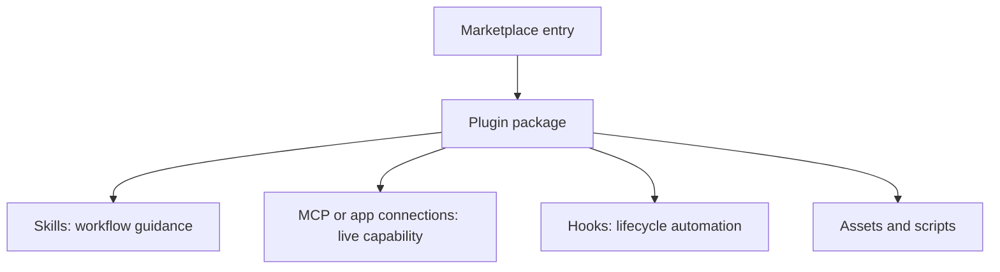

# Plugins

Plugins package reusable skills, connections, hooks, and supporting assets as
one installable workflow. Use a plugin when distribution and capability
composition matter; keep a simple workflow as a standalone skill.

## Learning objectives

- Distinguish a skill from a plugin and marketplace.
- Understand portable and Codex compatibility layouts.
- Build a focused manifest with real component paths.
- Review permissions, connections, and hook trust.
- Validate, install, test, update, and remove a local plugin.
- Choose a distribution scope without leaking credentials or local state.

## Plugin architecture



A marketplace is a catalog, not the plugin itself. Its entries identify where
packages come from and whether they are available or installed by default. The
plugin manifest identifies the package and its components.

Installing a plugin does not grant broader repository, host, or service access.
Codex still applies its sandbox and approval policy, while connected services
apply their own authentication and authorization.

## Skill or plugin?

| Need                                        | Use              |
| ------------------------------------------- | ---------------- |
| One repeatable instruction workflow         | Standalone skill |
| Several related skills distributed together | Plugin           |
| Workflow plus MCP or app connection         | Plugin           |
| Workflow plus lifecycle hooks               | Plugin           |
| Ordered catalog for a team or repository    | Marketplace      |

Do not create a plugin merely to add branding around one private prompt. The
extra manifest, install, update, and trust lifecycle should solve a real
distribution problem.

## Package layouts

The current portable Agent Plugins layout uses a root manifest:

```text
my-plugin/
├── plugin.json
├── skills/
├── mcp.json
├── hooks/
└── assets/
```

The portable `plugin.json` declares the Agent Plugins schema. Fixed root paths
discover `skills/` and `mcp.json`; OpenAI-specific presentation or hook settings
belong under `extensions.com.openai`.

Codex also supports the compatibility layout produced by `$plugin-creator`:

```text
my-plugin/
├── .codex-plugin/
│   └── plugin.json
├── skills/
├── hooks/
├── scripts/
├── assets/
├── .mcp.json
└── .app.json
```

Only `.codex-plugin/plugin.json` is required in that scaffold. Optional files
must exist before the manifest references them. The examples in this module use
this compatibility layout so they can be validated with the bundled creator.
For a new cross-host public package, evaluate the portable standard first.

Do not rename `.mcp.json` to `mcp.json` mechanically: the portable MCP schema
also requires transport information.

## Minimal compatibility manifest

```json
{
  "name": "change-review",
  "version": "0.1.0",
  "description": "Review local changes for actionable risks.",
  "author": {
    "name": "Example team"
  },
  "skills": "./skills/",
  "interface": {
    "displayName": "Change Review",
    "shortDescription": "Review a local change",
    "longDescription": "Inspect a diff for correctness and test risks.",
    "developerName": "Example team",
    "category": "Developer Tools",
    "capabilities": ["Read"],
    "defaultPrompt": ["Review the current diff."]
  }
}
```

Keep `name` stable, use strict semantic versions, and ensure every relative path
stays inside the plugin root. Never place tokens, cookies, or personal account
identifiers in a manifest.

## Components and permissions

### Skills

Bundled skills live under `skills/<skill-name>/SKILL.md`. Each skill still needs
a discriminating description and should preserve the user's scope. Installing
a plugin makes its skills available in a new chat or CLI session.

### MCP servers and apps

Connections add live data or actions. Document what identity is used, which
tools can mutate state, and whether authentication occurs during installation
or first use. A plugin does not inherit access to data the user cannot already
reach through the connected service.

### Hooks

Codex discovers `hooks/hooks.json` by default in an enabled compatibility
plugin. Installing or enabling the plugin does not trust its hook definitions.
Users must review them, and any change to the definition requires review again.

Hook scripts must exist in the execution environment. Use `PLUGIN_ROOT` for
read-only installed resources and `PLUGIN_DATA` for writable plugin state.

### Assets and scripts

Assets are templates or media used in generated output. Scripts should perform
small deterministic operations and must be tested independently. Do not hide
network calls or side effects inside a helper that appears to be a validator.

## Supported surfaces

Plugins are available in supported ChatGPT surfaces, Codex in the ChatGPT
desktop app, and Codex CLI. The Codex IDE extension does not currently provide
the plugin browser. Surface and workspace availability can vary, especially for
OAuth connections or administrator-controlled plugins.

In Codex CLI, open `/plugins` to browse configured marketplaces. After install,
start a new session so bundled skills and tools are discovered.

## Create with Plugin Creator

Describe the package boundary and optional components explicitly:

```text
$plugin-creator Create a local plugin named change-review with one bundled
review skill. It must not publish comments or modify files. Add no MCP server,
app, hook, or marketplace entry.
```

The scaffold normalizes names, creates `.codex-plugin/plugin.json`, and can add
only the requested optional directories. Remove no required structure and
replace all scaffold placeholders before validation.

## Local marketplaces

A repository marketplace lives at `.agents/plugins/marketplace.json`. A
personal marketplace lives at `~/.agents/plugins/marketplace.json`.

```json
{
  "name": "tutorial-plugins",
  "interface": {
    "displayName": "Tutorial Plugins"
  },
  "plugins": [
    {
      "name": "pr-review",
      "source": {
        "source": "local",
        "path": "./plugins/pr-review"
      },
      "policy": {
        "installation": "AVAILABLE",
        "authentication": "ON_INSTALL"
      },
      "category": "Developer Tools"
    }
  ]
}
```

Paths are relative to the marketplace root and must begin with `./`. Every
entry includes installation policy, authentication policy, and category.
Marketplace order is display order.

Use the creator to generate marketplace entries instead of hand-editing them
during normal local development. Non-default marketplace paths must be added
before installation:

```bash
codex plugin marketplace add /absolute/path/to/marketplace-root
codex plugin marketplace list
codex plugin add pr-review@tutorial-plugins
```

The default personal marketplace is discovered automatically and does not need
`codex plugin marketplace add`.

## Copy-ready example plugins

| Plugin                                                           | Included components                       | External connection | Mutation boundary                     |
| ---------------------------------------------------------------- | ----------------------------------------- | ------------------- | ------------------------------------- |
| [PR Review](examples/pr-review/skills/review-change/SKILL.md) | Review skill                              | None                | Read-only unless separately requested |
| [Documentation Maintenance](examples/documentation-maintenance/skills/maintain-docs/SKILL.md) | Skill and release-note asset | None | Edits local docs only when requested |
| [DevOps Readiness](examples/devops-readiness/skills/assess-deployment-readiness/SKILL.md) | Skill, validator, tests, and session hook | None | Assessment only; never deploys |

These examples deliberately avoid live MCP servers and credentials. They show
package composition without requiring an external account.

## Hands-on exercise: validate a read-only plugin package

This exercise uses the `devops-readiness` example because it contains a
manifest, a skill, a deterministic validator, and tests without deploying
anything or connecting to an external service. Follow the steps in order. The
first directory in which you run Codex must be the disposable practice
repository, not this tutorial checkout.

### Step 0 — Enter the tutorial checkout

```bash
cd /path/to/codex-howto
TUTORIAL_ROOT="$PWD"
```

### Step 1 — Create an isolated practice repository

Create the practice project outside this checkout, outside another repository,
and outside a parent tree that already contains a project-level `AGENTS.md`.
This keeps plugin files and test data separate from the tutorial source.

```bash
PRACTICE_ROOT="$(mktemp -d "${TMPDIR:-/tmp}/codex-plugins-practice.XXXXXX")"
git init -q "$PRACTICE_ROOT"
mkdir -p "$PRACTICE_ROOT/plugins"
cp -R 07-plugins/examples/devops-readiness "$PRACTICE_ROOT/plugins/"
printf '%s\n' '# Plugin practice project' > "$PRACTICE_ROOT/README.md"
printf 'Practice project: %s\n' "$PRACTICE_ROOT"
test "$(git -C "$PRACTICE_ROOT" rev-parse --show-toplevel)" = "$PRACTICE_ROOT"
find "$PRACTICE_ROOT" \( -name 'AGENTS.md' -o -name 'AGENTS.override.md' \) -print
```

The final command should print nothing. If you already know how to create an
isolated practice project, you may skip the setup block, assign its absolute
path to `PRACTICE_ROOT`, and copy the same plugin directory yourself.

### Step 2 — Inspect the package boundary before running it

Enter the practice project and inspect the manifest and skill before trusting
any component:

```bash
cd "$PRACTICE_ROOT"
pwd
sed -n '1,160p' plugins/devops-readiness/.codex-plugin/plugin.json
sed -n '1,180p' plugins/devops-readiness/skills/assess-deployment-readiness/SKILL.md
rg -n 'token|secret|api[_-]?key|curl|wget|deploy|rollback|PLUGIN_ROOT' plugins/devops-readiness
```

Expected result: the manifest points to `./skills/`, the skill explicitly says
that it does not deploy or mutate infrastructure, and the package contains no
credentials or hidden network command. `PLUGIN_ROOT` is a path supplied by the
plugin runtime; it is not a secret.

### Step 3 — Run the package's deterministic tests

Run the bundled tests before attempting installation or invocation:

```bash
python3 plugins/devops-readiness/scripts/test_check_deployment_plan.py
```

Expected result: all tests pass. These tests validate the plan structure only;
they do not prove that a deployment is safe and do not contact infrastructure.

### Step 4 — Test complete and incomplete plans

Create two synthetic plans in the practice project. They contain no real host,
credential, account, or release identifier.

```bash
cat > complete-plan.json <<'EOF'
{
  "environment": "staging",
  "version": "example-version",
  "owner": "release manager",
  "rollback_trigger": "error budget threshold exceeded",
  "preflight_checks": ["tests passed"],
  "monitoring_signals": ["request error rate"],
  "rollback_steps": ["restore the previous approved version"]
}
EOF
printf '%s\n' '{"environment":"staging"}' > incomplete-plan.json
python3 plugins/devops-readiness/scripts/check_deployment_plan.py complete-plan.json
python3 plugins/devops-readiness/scripts/check_deployment_plan.py incomplete-plan.json; test "$?" -eq 1
```

Expected result: the complete plan reports that its structure is complete; the
incomplete plan returns exit code `1` and lists missing fields. The validator
does not approve, deploy, rollback, or contact an external service.

### Step 5 — Review the skill boundary with Codex

Start Codex from the practice project:

```bash
codex
```

Confirm `/pwd` reports `$PRACTICE_ROOT`, then ask:

```text
Review plugins/devops-readiness/complete-plan.json using the local
devops-readiness plugin package. Report readiness status, confirmed evidence,
missing evidence, rollback or monitoring gaps, and one next safe verification
step. Do not deploy, approve, mutate infrastructure, or send notifications.
```

Expected result: the response is an assessment only, cites the synthetic plan,
and preserves the plugin's no-deploy boundary. If the plugin is not installed
on your surface, inspect the skill file and explain how its trigger and output
contract would be tested; do not install an unreviewed package just to force the
demo.

### Step 6 — Verify the working tree and package contents

Exit Codex and run:

```bash
git status --short
git diff -- README.md
test -f plugins/devops-readiness/.codex-plugin/plugin.json
test -f plugins/devops-readiness/skills/assess-deployment-readiness/SKILL.md
test -f plugins/devops-readiness/scripts/check_deployment_plan.py
```

Expected result: the practice files are untracked, no source file outside the
practice project changed, and all referenced component paths exist. Structural
validation is evidence about packaging, not authorization to install or run
external actions.

### Success criteria

- The manifest and every referenced component path are reviewed and present.
- Bundled tests pass and distinguish complete from incomplete plans.
- The skill output is an assessment, never a deployment approval or action.
- No credentials, hidden network calls, or real infrastructure are used.
- You can explain the difference between a plugin, a skill, a marketplace, and
  the host's permission/trust controls.

### What you learned

You practiced reviewing plugin composition, validating deterministic scripts,
testing a skill's mutation boundary, and separating package structure from
runtime authorization.

### Step 7 — Clean up

Exit Codex and remove only the disposable project:

```bash
cd "$TUTORIAL_ROOT"
rm -rf "$PRACTICE_ROOT"
unset PRACTICE_ROOT TUTORIAL_ROOT
```

Do not substitute the Codex How To repository path for `$PRACTICE_ROOT`.

## Validate the examples

From the `plugin-creator` skill directory, validate each package:

```bash
python3 scripts/validate_plugin.py \
  /absolute/path/to/07-plugins/examples/pr-review
```

Validate bundled skills separately with `skill-creator`, then test any scripts:

```bash
python3 scripts/quick_validate.py \
  /absolute/path/to/07-plugins/examples/pr-review/skills/review-change

python3 07-plugins/examples/devops-readiness/scripts/test_check_deployment_plan.py
```

Structural validation does not prove that routing, permissions, or results are
useful. Test realistic requests and neighboring requests that should not select
the plugin.

## Representative test workflows

### PR Review

1. Install the plugin in a disposable repository with a small committed change.
2. Ask it to review the diff without editing files.
3. Confirm findings cite evidence and omit style-only noise.
4. Ask it to implement a fix; confirm it does not treat review as authorization
   to edit.

### Documentation Maintenance

1. Provide a verified behavior change and request a focused docs update.
2. Confirm it inspects the source before changing prose.
3. Request release notes and verify the bundled template is used without
   invented claims.
4. Confirm it does not publish or tag a release.

### DevOps Readiness

1. Run the bundled unit test for the plan validator.
2. Provide one complete and one incomplete JSON plan.
3. Confirm the plugin distinguishes structural completeness from operational
   evidence.
4. Ask it to deploy; confirm it stops at readiness assessment.
5. Review and trust the session hook separately before enabling it.

## Update and removal

Local installs are cached. During compatibility-plugin development, use Plugin
Creator's cachebuster helper and reinstall from the validated marketplace name;
do not keep appending arbitrary version suffixes or rewrite marketplace files by
hand. Start a new session after reinstalling.

Inspect and remove through current CLI commands:

```bash
codex plugin list
codex plugin remove pr-review@tutorial-plugins
```

Removing a plugin removes its bundle from that environment. A separately
authorized external connection may need to be disconnected independently.

## Security review checklist

Before installation, inspect:

- manifest identity, version, publisher, and all relative paths;
- every bundled skill's trigger and mutation boundary;
- MCP or app identities, tools, scopes, and authentication timing;
- hook events, matchers, commands, trust status, and writable paths;
- scripts for hidden network calls, credential reads, or destructive behavior;
- marketplace source, pinned ref or version, and update policy.

## Troubleshooting

### The plugin does not appear

Validate the marketplace path, top-level name, plugin entry, source path, and
manifest name. Restart the supported client after adding the source.

### Skills are missing after install

Start a new chat or CLI session. Confirm the manifest points to `./skills/` and
every skill has valid frontmatter.

### A hook is skipped

Open `/hooks`, inspect its installed source, and review the current definition.
Plugin installation alone does not grant hook trust.

### An MCP-backed feature is unavailable

Check the connection mapping, server authentication, workspace policy, and the
current surface. Do not solve an authentication failure by embedding a secret in
the plugin.

## Next step

Continue to [Safety and worktrees](../08-safety-and-worktrees/README.md) to choose
enforcement boundaries and isolate concurrent changes.

## Official resources

- [Plugins](https://learn.chatgpt.com/docs/plugins)
- [Build plugins](https://learn.chatgpt.com/docs/build-plugins)
- [Package your plugin](https://developers.openai.com/plugins/build/plugins)
- [Hooks](https://learn.chatgpt.com/docs/hooks)
