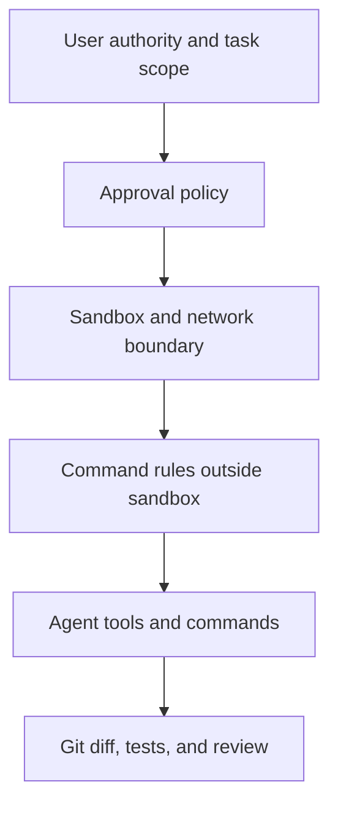

# Safety and worktrees

Safe Codex operation combines least-privilege runtime permissions, explicit
authority for consequential actions, reviewable Git changes, and isolated
workspaces where parallel work would otherwise collide.

## Learning objectives

- Distinguish sandbox boundaries, approvals, rules, instructions, and Git.
- Choose a permission posture appropriate to the task.
- Inspect effective settings before granting an exception.
- Test command rules without running the target command.
- Use worktrees to isolate changes and review them before integration.
- Recover or clean up work without targeting the wrong checkout.

## The control layers



These layers solve different problems:

| Control                | Governs                                           | Does not guarantee               |
| ---------------------- | ------------------------------------------------- | -------------------------------- |
| User request           | Intended outcome and authorized scope             | Technical isolation              |
| Sandbox                | Filesystem and command/network boundary           | Correct intent or code           |
| Approval policy        | When a boundary crossing pauses                   | That approved work is safe       |
| Rules                  | Prefix decisions for commands outside the sandbox | Full shell or application policy |
| `AGENTS.md` and skills | Agent behavior and workflow                       | Enforcement against hostile code |
| Git and worktrees      | Review, recovery, and checkout isolation          | Runtime least privilege          |

Use multiple layers. A worktree does not make `danger-full-access` safe, and an
instruction such as “do not delete files” is not a filesystem boundary.

## Sandbox modes

| Mode                 | Practical meaning                             | Typical use                      |
| -------------------- | --------------------------------------------- | -------------------------------- |
| `read-only`          | Inspect without workspace edits               | Review, inventory, analysis      |
| `workspace-write`    | Read and write inside workspace roots         | Normal implementation            |
| `danger-full-access` | No sandbox filesystem or network restrictions | Exceptional isolated environment |

In `workspace-write`, network access is off by default unless enabled by the
effective configuration. Protected paths such as `.git` can remain read-only
even inside a writable root.

Prefer adding one required directory with `--add-dir` or a writable-root setting
over removing the sandbox. Never broaden access merely to avoid understanding a
failed command.

## Approval policy and reviewer

The common approval policies are:

- `on-request`: work inside the sandbox and request a boundary exception when
  needed.
- `never`: do not stop for an approval prompt; denied operations fail instead.

With interactive approvals, `approvals_reviewer = "user"` sends requests to the
user. `auto_review` routes eligible requests to an automatic reviewer, but it
does not change the sandbox boundary.

Full access combines `danger-full-access` with `never`. Treat it as an explicit
high-risk choice, not as a troubleshooting shortcut.

## Least-privilege configuration

[`examples/least-privilege-config.toml`](examples/least-privilege-config.toml)
shows stable sandbox settings for a trusted local project:

```toml
approval_policy = "on-request"
approvals_reviewer = "user"
sandbox_mode = "workspace-write"

[sandbox_workspace_write]
network_access = false
writable_roots = []
```

Keep personal defaults in `~/.codex/config.toml`. Put repository-specific
overrides in `.codex/config.toml`; Codex loads that layer only after the project
is trusted. Use `/status` to inspect the active mode and roots, and
`/debug-config` to identify the layer that supplied a setting.

Beta permission profiles provide finer filesystem and network policy, but they
do not compose with legacy `sandbox_mode` settings. Do not mix both models in a
single tutorial configuration.

## Command rules

Rules control which command prefixes Codex can run outside the sandbox. They are
experimental and use Starlark files under `rules/` beside an active config
layer, such as `.codex/rules/default.rules` in a trusted project.
Save the following example as `<repo>/.codex/rules/default.rules`; it is not a
shell command and must not be pasted into `config.toml` or `AGENTS.md`.

```starlark
prefix_rule(
    pattern = ["gh", "pr", ["view", "list"]],
    decision = "prompt",
    justification = "Remote pull-request access requires review.",
    match = ["gh pr view 42", "gh pr list"],
    not_match = ["gh issue list"],
)
```

The decisions are `allow`, `prompt`, and `forbidden`. When several rules match,
the most restrictive decision wins. Make prefixes categorical and narrow; an
overly broad allow rule can authorize unexpected arguments.

Test [`examples/default.rules`](examples/default.rules) without running the
target command:

```bash
codex execpolicy check --pretty \
  --rules 08-safety-and-worktrees/examples/default.rules \
  -- gh pr view 42
```

Shell wrappers and complex syntax can change how a command is evaluated. Do not
use prefix rules as a complete shell-security language.

## Authority for external state

A technically permitted action can still be outside the user's request. Ask for
explicit authority before publishing, deploying, merging, sending messages,
changing account configuration, or deleting material data.

Before approval, check:

1. The exact target and intended effect.
2. Whether the action is recoverable.
3. Which identity and external account will be used.
4. Whether a narrower operation achieves the same goal.
5. What evidence will confirm success.

Approval for one action is not permission for a broader sequence.

## Git as a recovery layer

Before risky implementation work:

- inspect `git status --short` and the current branch;
- preserve unrelated changes;
- make small, reviewable edits;
- run relevant tests;
- inspect `git diff --check` and the final diff;
- commit or push only when explicitly requested.

Git cannot recover ignored files, untracked secrets, external service changes,
or destructive commands outside the repository. Backups and service-native
recovery still matter.

## Worktree model

A Git worktree is a second checkout that shares repository metadata and objects
with the original checkout. It isolates working files and index state so
independent chats can work without overwriting each other's local changes.

Use a worktree when:

- another task must proceed while the local checkout remains in use;
- a scheduled task may edit files in the background;
- you want a disposable change set for review;
- parallel agents own separate branches or components.

Do not use worktrees to hide overlapping ownership. Two tasks changing the same
interface still need coordination.

## Codex-managed worktrees

In the ChatGPT desktop app, select **Worktree** when starting a task. Codex
creates a managed checkout, usually in detached `HEAD`, under the configured
worktree root. Use **Create branch here** when the result should become a
long-lived branch.

Handoff moves a chat and its Git state between Local and its worktree. Ignored
files do not move automatically, so dependencies and local configuration may
need a setup script or an intentional `.worktreeinclude` policy.

Managed worktrees are lightweight and may be cleaned up. Pinned, active, and
permanent worktrees are retained; Codex saves a snapshot before deleting an
eligible managed worktree.

## Manual Git worktree workflow

Resolve all paths before creating or removing anything:

```bash
git status --short
git worktree list
git worktree add -b codex/docs-update ../codex-docs-update HEAD
```

Run Codex from the new checkout with normal least-privilege permissions:

```bash
codex -C ../codex-docs-update \
  --sandbox workspace-write \
  --ask-for-approval on-request
```

Review before integration:

```bash
git -C ../codex-docs-update status --short
git -C ../codex-docs-update diff --check
git -C ../codex-docs-update diff
```

When cleanup is requested, first confirm there is no work to preserve:

```bash
git -C ../codex-docs-update status --short
git worktree list
```

Then remove the exact verified worktree through Git:

```bash
git worktree remove ../codex-docs-update
git branch -d codex/docs-update
```

Do not add `--force` because cleanup is inconvenient. Preserve or explicitly
discard outstanding work first.

## Hands-on exercise: isolated documentation change

This exercise combines least-privilege settings, a command-rule check, and a
manual Git worktree. It never runs a destructive command or contacts a remote
service. Follow the steps in order. The first directory in which you run Codex
must be the practice repository or its dedicated worktree, not this checkout.

### Step 0 — Enter the tutorial checkout

```bash
cd /path/to/codex-howto
TUTORIAL_ROOT="$PWD"
```

### Step 1 — Create a clean practice repository

Create the repository outside this checkout, outside another repository, and
outside a parent tree that already contains a project-level `AGENTS.md`.

```bash
PRACTICE_ROOT="$(mktemp -d "${TMPDIR:-/tmp}/codex-safety-practice.XXXXXX")"
git init -q "$PRACTICE_ROOT"
printf '%s\n' '# Safety practice project' '' 'Baseline documentation.' > "$PRACTICE_ROOT/README.md"
git -C "$PRACTICE_ROOT" add README.md
git -C "$PRACTICE_ROOT" -c user.name='Codex learner' -c user.email='codex-learner.invalid' commit -qm 'Create safety baseline'
mkdir -p "$PRACTICE_ROOT/.codex/rules"
cp 08-safety-and-worktrees/examples/default.rules "$PRACTICE_ROOT/.codex/rules/default.rules"
cp 08-safety-and-worktrees/examples/least-privilege-config.toml "$PRACTICE_ROOT/.codex/config.toml"
printf 'Practice project: %s\n' "$PRACTICE_ROOT"
test "$(git -C "$PRACTICE_ROOT" rev-parse --show-toplevel)" = "$PRACTICE_ROOT"
git -C "$PRACTICE_ROOT" status --short
find "$PRACTICE_ROOT" \( -name 'AGENTS.md' -o -name 'AGENTS.override.md' \) -print
```

Expected result: the Git status is clean and the final `find` command prints
nothing. If you already know how to create a clean practice repository, you may
skip this setup block, assign its absolute path to `PRACTICE_ROOT`, and prepare
the same config and rules files yourself.

### Step 2 — Test rules without running their target commands

From the practice repository, check one prompt rule and one forbidden rule:

```bash
cd "$PRACTICE_ROOT"
codex execpolicy check --pretty --rules .codex/rules/default.rules -- gh pr view 42
codex execpolicy check --pretty --rules .codex/rules/default.rules -- git push --force origin example-branch
```

Expected result: the first command reports `prompt`; the second reports
`forbidden`. These commands inspect decisions only—they do not run `gh` or
`git push`. Also check negative examples:

```bash
codex execpolicy check --pretty --rules .codex/rules/default.rules -- gh issue list
codex execpolicy check --pretty --rules .codex/rules/default.rules -- git push origin example-branch
```

Record the decisions before continuing. An unexpected broad match is a reason
to narrow the rule, not to grant full access.

### Step 3 — Create and inspect an exact worktree

Resolve the worktree path before creating it. Use a sibling path outside the
main checkout:

```bash
WORKTREE_ROOT="${PRACTICE_ROOT}-worktree"
git -C "$PRACTICE_ROOT" worktree add -b codex/docs-update "$WORKTREE_ROOT" HEAD
git -C "$PRACTICE_ROOT" worktree list
git -C "$WORKTREE_ROOT" status --short
```

Expected result: Git lists both checkouts and the new worktree starts clean on
branch `codex/docs-update`.

### Step 4 — Start Codex with least privilege in the worktree

```bash
codex --cd "$WORKTREE_ROOT" --sandbox workspace-write --ask-for-approval on-request
```

Inside Codex, run `/pwd` and `/status`. Confirm that the directory is
`$WORKTREE_ROOT`, the sandbox is `workspace-write`, and full access is not
enabled. Do not use `danger-full-access` to bypass a failed write or approval.

### Step 5 — Request one bounded documentation edit

Use this complete prompt:

```text
In this worktree, edit only README.md. Add a short section titled
"## Worktree verification" with two sentences explaining that this checkout is
an isolated branch and that the original checkout remains unchanged. Do not
edit configuration, rules, or Git metadata. Do not run network commands. Show
the diff and run `git diff --check`.
```

Expected result: only the worktree's `README.md` changes. Codex may ask for
approval for a command; inspect the exact request before approving it.

### Step 6 — Review from both checkouts

Exit Codex and compare the worktree with the original checkout:

```bash
git -C "$WORKTREE_ROOT" status --short
git -C "$WORKTREE_ROOT" diff --check
git -C "$WORKTREE_ROOT" diff -- README.md
git -C "$PRACTICE_ROOT" status --short
git -C "$PRACTICE_ROOT" diff -- README.md
```

Expected result: the worktree shows only the intended README edit; the original
checkout remains clean and has no copy of that edit. This demonstrates checkout
isolation, not a security boundary—the same commands could still affect the
worktree if permissions allowed them.

### Step 7 — Choose an explicit recovery path

For this disposable exercise, do not merge or push. First confirm that no work
must be retained, then remove the exact worktree and branch:

```bash
git -C "$WORKTREE_ROOT" status --short
git -C "$PRACTICE_ROOT" worktree list
git -C "$PRACTICE_ROOT" worktree remove "$WORKTREE_ROOT"
git -C "$PRACTICE_ROOT" branch -d codex/docs-update
```

If the status is not what you expect, stop and preserve the work instead of
adding `--force`. A real project should commit, review, and integrate changes
according to its normal workflow before cleanup.

### Success criteria

- Rule checks distinguish prompt, forbidden, and negative examples without
  executing target commands.
- The worktree starts clean and has an exact, verified path.
- Codex runs with `workspace-write` and `on-request`, not full access.
- Only the worktree README changes; the original checkout remains unchanged.
- Cleanup occurs only after status inspection and never uses forced removal.

### What you learned

You practiced layering user authority, approval policy, sandbox, command rules,
and Git review. You also saw what worktrees isolate—working files and index
state—and what they do not isolate: permissions, external services, or unsafe
commands.

### Step 8 — Clean up the disposable repository

Return to the tutorial checkout, then remove only the exact temporary project:

```bash
cd "$TUTORIAL_ROOT"
rm -rf "$PRACTICE_ROOT"
unset PRACTICE_ROOT WORKTREE_ROOT TUTORIAL_ROOT
```

Do not substitute the Codex How To repository path for `$PRACTICE_ROOT`.

## Troubleshooting

### Codex cannot write a required path

Inspect `/status` and `/debug-config`. Add only the required root or move the
task into the correct project instead of choosing full access.

### A rule matches too broadly

Narrow its argument prefix, add `not_match` examples, and rerun
`codex execpolicy check` with positive and negative cases.

### Dependencies are missing in a worktree

Ignored build output and dependencies are not guaranteed to follow the
checkout. Configure a reviewed local-environment setup script or install them
inside that worktree.

### Git refuses to remove a worktree

Inspect its status and resolve tracked or untracked work. Avoid forced removal
until the user has explicitly chosen to discard the exact remaining changes.

## Next step

Continue to [Advanced workflows](../09-advanced-workflows/README.md) to coordinate
planning, long-running tasks, execution environments, and schedules.

## Official resources

- [Sandbox](https://learn.chatgpt.com/docs/sandboxing)
- [Rules](https://learn.chatgpt.com/docs/agent-configuration/rules)
- [Worktrees](https://learn.chatgpt.com/docs/environments/git-worktrees)
- [Permissions](https://learn.chatgpt.com/docs/permissions)
