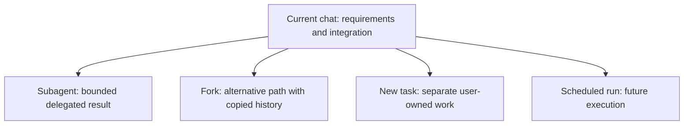

# Advanced workflows

Advanced Codex work is less about adding tools and more about choosing the
right unit of work, execution environment, persistence model, and stopping
condition. Keep requirements and decisions visible while moving noisy or
long-running work into the appropriate place.

## Learning objectives

- Choose between direct execution, Plan mode, an execution plan, and Goal mode.
- Distinguish the current chat, a subagent, a fork, and a separate user-owned
  task.
- Select Local, Worktree, or Cloud execution based on actual dependencies.
- Monitor long-running work without busy polling.
- Design scheduled workflows with durable prompts and clear stopping behavior.
- Combine skills, plugins, browser checks, and human review safely.

## Choose the planning depth

| Situation                                             | Use                                     |
| ----------------------------------------------------- | --------------------------------------- |
| Small, well-scoped change                             | Direct implementation with verification |
| Ambiguous or multi-step work                          | Plan mode with `/plan`                  |
| Long implementation that must survive context changes | Repository execution plan               |
| Persistent objective with progress tracking           | Goal mode with `/goal`                  |

Plan mode is for exploring requirements and agreeing on approach before edits.
It does not grant additional permissions. After the plan is accepted, return to
an implementation-capable mode and keep the plan updated as evidence changes.

For longer work, store the durable plan in the repository. The template at
[`examples/PLANS.md`](examples/PLANS.md) captures scope, decisions, progress,
verification, and recovery without pretending that the first design is fixed.

Use `/goal` only when a concrete objective should remain attached to the active
chat across many steps. Shape a complex goal with `/plan` first. Pause or revise
the goal when assumptions change rather than silently pursuing stale scope.

## Units of work

- **Current chat**: owns user decisions, final integration, and the authoritative
  scope.
- **Subagent**: performs a bounded specialist or parallel subtask and returns a
  result to its parent.
- **Fork**: copies completed conversation history so an alternative can evolve
  independently.
- **New task**: appears separately for the user and should be created only when
  they explicitly ask for separate work.
- **Scheduled run**: executes later using a saved prompt and selected context.

Do not create a visible task merely to hide internal delegation. Do not use a
subagent when the user needs an independently owned task they can revisit.

## Execution environments

| Environment | Files and processes                             | Best fit                                                |
| ----------- | ----------------------------------------------- | ------------------------------------------------------- |
| Local       | Current computer and selected checkout          | Interactive work requiring local tools or sign-ins      |
| Worktree    | Separate Git checkout on the same computer      | Isolated parallel or background changes                 |
| Cloud       | Isolated workspace from a published environment | Work that should continue independently of the computer |

A Cloud task receives the repositories, dependencies, tools, network policy,
and secrets configured in its published environment. It does not automatically
receive local files, processes, VPN access, browser sessions, or personal
skills. Repository skills remain available when committed in the selected
repository.

New Cloud tasks start from the published environment. Existing tasks retain
their own state; republishing the environment does not rewrite them.

## Move work deliberately

Use a Worktree when local isolation is the main requirement. Use Handoff to move
an app chat and its Git state between Local and its associated worktree when you
want to foreground or background that same work.

Use Cloud when the workflow can be reproduced from published environment state
and should continue while the computer is unavailable. Before moving work,
inventory dependencies that are only local:

- uncommitted or ignored files;
- development services;
- browser or desktop-app sign-ins;
- VPN and private network access;
- personal skills and MCP configuration;
- environment variables and credentials.

Transfer requirements through reviewed configuration, not copied secrets.

## Long-running commands

Start a long-running command only when its output or service is needed. Capture
the command, working directory, process/session identifier, expected readiness
signal, and stopping condition.

Prefer event-driven waits or terminal-session polling that returns when output
changes. Do not run tight status loops. While work continues:

1. report meaningful progress rather than unchanged snapshots;
2. surface approval or user-input requests immediately;
3. preserve logs needed for diagnosis without exposing secrets;
4. terminate the exact process when it is no longer needed;
5. verify cleanup rather than assuming it occurred.

If the work belongs in a separate task, use product task controls instead of
keeping an invisible terminal alive indefinitely.

## Browser-assisted verification

Use a browser when visual or interactive state is part of correctness: routing,
forms, responsive layout, authenticated flows, or console errors. Start the
local service in a controlled terminal, wait for its readiness signal, and open
the exact URL.

Browser state is surface-specific. A local signed-in browser session is not
available automatically to Cloud tasks, and Cloud environments currently do
not provide general computer or browser use. Use API or MCP integration when a
workflow needs durable structured access rather than visual interaction.

Never treat a screenshot alone as proof that data was saved. Verify the
underlying application state when the task requires it.

## Scheduled tasks

Scheduled tasks are account- and workspace-dependent. The ChatGPT desktop app
can run tasks against local projects in the checkout or a dedicated worktree;
the computer must remain on and the app running. Web scheduled tasks can use
uploaded context and connected tools but cannot directly work in a local folder.

The Codex CLI and IDE extension do not provide the Scheduled management UI.
They can prepare and test the prompt, skill, or script before it is scheduled in
a supported surface.

Choose the schedule shape:

| Need                                                  | Shape                         |
| ----------------------------------------------------- | ----------------------------- |
| Continue the same investigation with existing context | Scheduled task in a chat      |
| Independent report on every run                       | Standalone scheduled task     |
| React to supported Gmail, Slack, or GitHub activity   | Event trigger, when available |
| One immediate non-interactive run                     | `codex exec`, not a schedule  |

For repository-writing schedules, prefer a worktree so a background run cannot
overwrite unfinished local work. Scheduled tasks run unattended with default
sandbox settings, so narrow those defaults before scheduling.

## Write a durable scheduled prompt

The prompt must make sense on every run. Include:

- the exact scope and data source;
- the skill or plugin to invoke when routing must be deterministic;
- what changed since the previous run, if that state is available;
- success, no-change, and failure outputs;
- which actions require human approval;
- when to stop, pause, or ask for input;
- what evidence and links to return.

Use [`examples/scheduled-doc-check.md`](examples/scheduled-doc-check.md) as a
safe read-only example. Test it manually in an ordinary chat before creating a
schedule, then inspect the first several runs.

Skills define the method; scheduled tasks define when and where the method runs.
Stabilize the workflow as a skill before scheduling it if each manual run still
requires substantial steering.

## End-to-end workflow: planned feature in a worktree

1. Start in Local and use `/plan` to clarify behavior, risks, and verification.
2. Save a durable execution plan when the change will span many turns.
3. Start or hand off the task to a Worktree.
4. Delegate only independent investigations to subagents.
5. Implement in bounded slices and update plan progress after verified results.
6. Keep long-running services in named terminal sessions and stop them after
   browser verification.
7. Inspect the worktree diff and test output.
8. Hand off to Local or create a branch only when ready for user review.
9. Commit, push, or open a pull request only when authorized.

## End-to-end workflow: recurring read-only check

1. Run the proposed prompt manually with read-only permissions.
2. Package stable analysis steps in a skill.
3. Choose chat-attached or standalone scheduling based on context needs.
4. Select a local worktree only if the run needs repository files; otherwise use
   accessible web or connected context.
5. Define a no-change result so silence is distinguishable from failure.
6. Review the first runs and narrow noisy triggers or outputs.
7. Pause the task when the underlying project, model, connection, or owner
   changes.

## Hands-on exercise

Design a workflow for a feature that requires repository research, a local UI
check, and a weekly documentation-drift report.

1. Write the implementation plan using `examples/PLANS.md`.
2. Assign research and integration to the current chat; delegate only one
   independent scan.
3. Choose Local or Worktree for the UI implementation and explain why Cloud is
   or is not suitable.
4. Define the server readiness signal and termination step.
5. Adapt `scheduled-doc-check.md` for the weekly report without enabling a
   schedule.
6. Identify every action that would require explicit external authority.

### Success criteria

- Each unit of work has one owner and output contract.
- Environment choice follows real dependencies rather than convenience.
- Long-running work has readiness and stopping conditions.
- The schedule prompt defines no-change and failure behavior.
- The workflow does not assume local secrets or sign-ins transfer to Cloud.

## Troubleshooting

### The plan no longer matches the code

Record the discovery and update the plan before continuing. A durable plan is a
decision log, not an immutable promise.

### A Cloud task cannot reach a local dependency

Publish the dependency or configure approved network access in the environment.
Do not copy a local credential or assume the Cloud task can use a browser login.

### A scheduled task modifies active local work

Pause it, inspect the exact changes, and switch future Git runs to a dedicated
worktree. Non-Git projects run scheduled tasks directly in the project folder.

### Monitoring consumes the whole conversation

Use event-driven waiting, lower the polling cadence, report only changes, or
move independently owned work into a separate task.

## Next step

Continue to [CLI and automation](../10-cli-and-automation/README.md) to turn bounded,
verified workflows into scripts and CI jobs.

## Official resources

- [Developer commands](https://learn.chatgpt.com/docs/developer-commands)
- [Codex environments](https://learn.chatgpt.com/docs/environments/modes)
- [Cloud environments](https://learn.chatgpt.com/docs/environments/cloud-environments)
- [Scheduled tasks](https://learn.chatgpt.com/docs/automations)
- [Worktrees](https://learn.chatgpt.com/docs/environments/git-worktrees)
