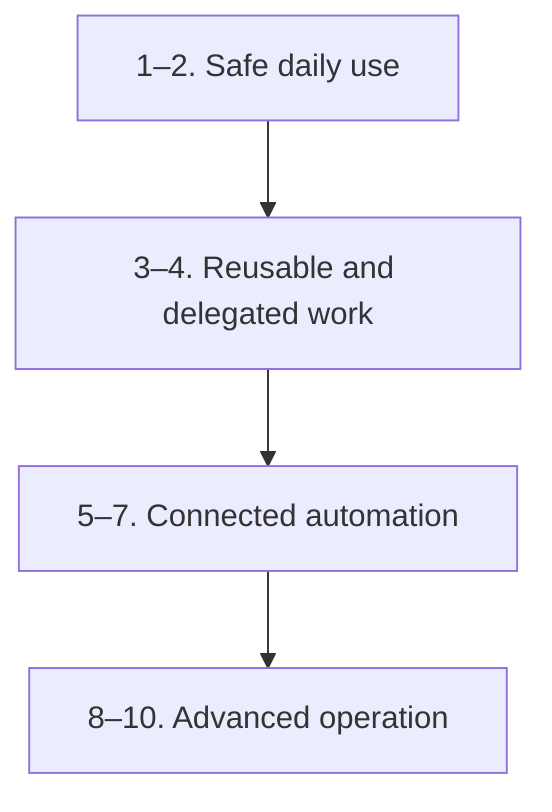
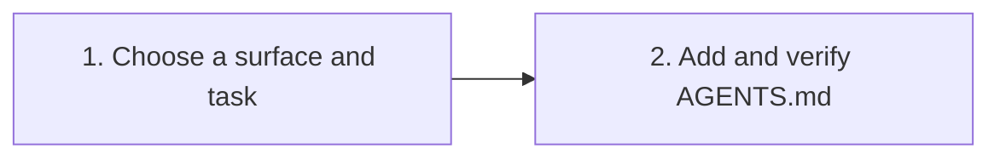
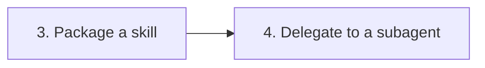
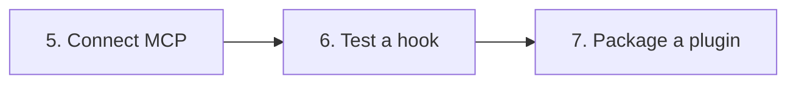
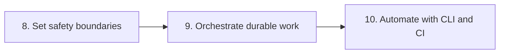

# Codex learning roadmap

This roadmap moves from a safe first repository task to reusable workflows, integrations, and advanced automation. If you are new to Codex, start with Module 1 and continue to Module 2 when you want durable repository guidance. Modules 3–10 are specialized; choose them when your work calls for those capabilities. Experienced users can use the self-check to choose a starting point.

Use the [glossary](GLOSSARY.md) whenever a term or abbreviation is unfamiliar.

The optional `$self-assessment` and `$lesson-quiz` skills are available when your Codex surface loads this repository's skills. You can use this roadmap and complete the module exercises without them.

## 1. Choose a starting point

Check the capabilities you can already demonstrate:

This nine-item checklist is a simple roadmap placement aid. It is not the eight-question quick score used by the interactive self-assessment skill.

- [ ] Open Codex on a repository and review its changes.
- [ ] Identify the Codex surface and permission mode in use.
- [ ] Explain how Codex finds `AGENTS.md` files.
- [ ] Create or install a skill.
- [ ] Delegate a bounded task to a subagent.
- [ ] Configure an MCP server.
- [ ] Configure and test a hook.
- [ ] Explain sandbox, approvals, rules, and worktrees.
- [ ] Use `codex exec` or a Codex automation.

| Checks completed | Suggested starting point                                                              | Primary goal                                                      |
| ---------------: | ------------------------------------------------------------------------------------- | ----------------------------------------------------------------- |
|              0–2 | [Milestone 1: Safe daily use](#milestone-1-safe-daily-use)                           | Complete repository work and encode durable instructions          |
|              3–4 | [Milestone 2: Reusable and delegated work](#milestone-2-reusable-and-delegated-work) | Package expertise and delegate bounded investigations             |
|              5–7 | [Milestone 3: Connected automation](#milestone-3-connected-automation)               | Connect tools, enforce lifecycle checks, and distribute workflows |
|              8–9 | [Milestone 4: Advanced operation](#milestone-4-advanced-operation)                   | Control authority, isolate changes, and automate reviewed work    |

When unsure, start one module earlier and complete its hands-on outcome before moving forward.

## 2. Roadmap at a glance

The overview groups the ten modules into four milestones. Each milestone below contains the detailed module links, child steps, and a practical checkpoint. Module 1 introduces permission basics before the later modules cover external integrations and automation; Module 8 is the in-depth safety reference.

| Milestone                      | Modules | Result                                                            |
| ------------------------------ | ------- | ----------------------------------------------------------------- |
| 1. Safe daily use              | 1–2     | Complete repository work and encode durable instructions          |
| 2. Reusable and delegated work | 3–4     | Package expertise and delegate bounded investigations             |
| 3. Connected automation        | 5–7     | Connect tools, enforce lifecycle checks, and distribute workflows |
| 4. Advanced operation          | 8–10    | Control authority, isolate changes, and automate reviewed work    |

## 3. Milestones and practice sequence

### Milestone 1 — Safe daily use

**Modules:** [1. Getting started](01-getting-started/README.md) · [2. Project instructions](02-agents-md/README.md)

**Goal:** Complete repository tasks with clear scope, review changes, and encode stable team conventions in `AGENTS.md`.

#### Milestone 1 practice checkpoint

- [ ] Finish the first-task exercise.
- [ ] Create a minimal project instruction file.
- [ ] Verify nested instruction behavior.

### Milestone 2 — Reusable and delegated work

**Modules:** [3. Skills](03-skills/README.md) · [4. Subagents](04-subagents/README.md)

**Goal:** Package a repeatable workflow as a skill and delegate a bounded, independent investigation to a subagent.

#### Milestone 2 practice checkpoint

- [ ] Build and invoke one project skill.
- [ ] Create one custom-agent TOML file.
- [ ] Compare sequential and parallel execution tradeoffs.

### Milestone 3 — Connected automation

**Modules:** [5. MCP](05-mcp/README.md) · [6. Hooks](06-hooks/README.md) · [7. Plugins](07-plugins/README.md)

**Goal:** Connect an external capability, automate a deterministic event, and distribute the combined workflow as a plugin.

#### Milestone 3 practice checkpoint

- [ ] Configure a least-privilege MCP server.
- [ ] Test a hook with sample JSON input.
- [ ] Validate a local plugin package.

### Milestone 4 — Advanced operation

**Modules:** [8. Safety and worktrees](08-safety-and-worktrees/README.md) · [9. Advanced
workflows](09-advanced-workflows/README.md) · [10. CLI and automation](10-cli-and-automation/README.md)

**Goal:** Choose appropriate permission boundaries, isolate changes, manage long-running work, and run Codex safely from scripts or CI.

#### Milestone 4 practice checkpoint

- [ ] Explain sandbox and approval policy independently.
- [ ] Complete an isolated worktree exercise.
- [ ] Build one reviewed non-interactive workflow.

## 4. Completion standard

A module is complete when you can:

1. Perform its hands-on outcome in the named Codex surface.
2. Explain what authority the example grants to Codex.
3. Reproduce the verification step without relying on hidden local state.
4. Describe one safe recovery path when the exercise fails.

For full curriculum coverage, complete all four milestones. Otherwise, use the [feature catalog](CATALOG.md) as a capability-first reference and return to the [complete index](INDEX.md) when you need a specific module.
